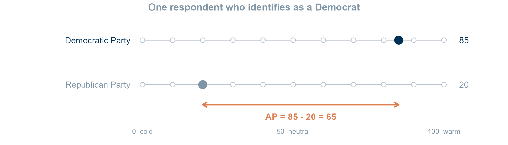
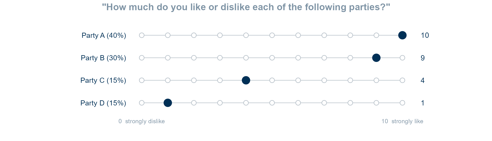
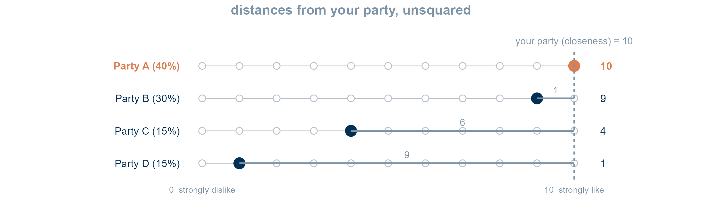
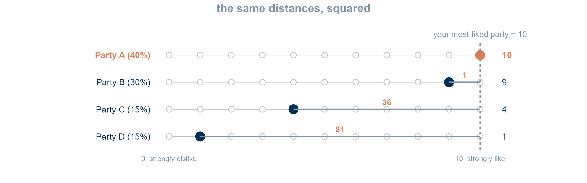
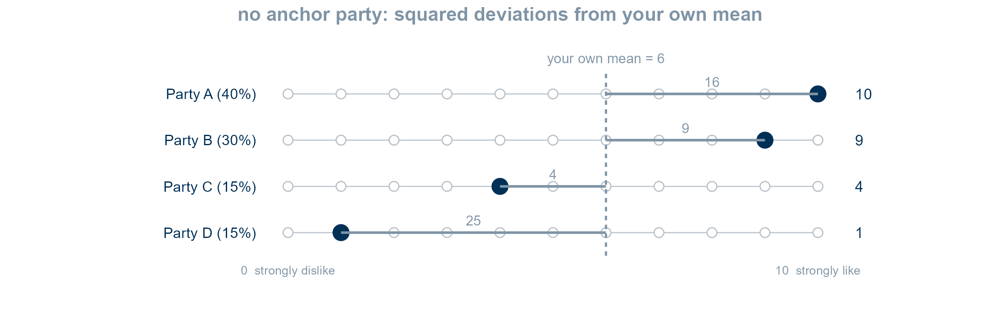
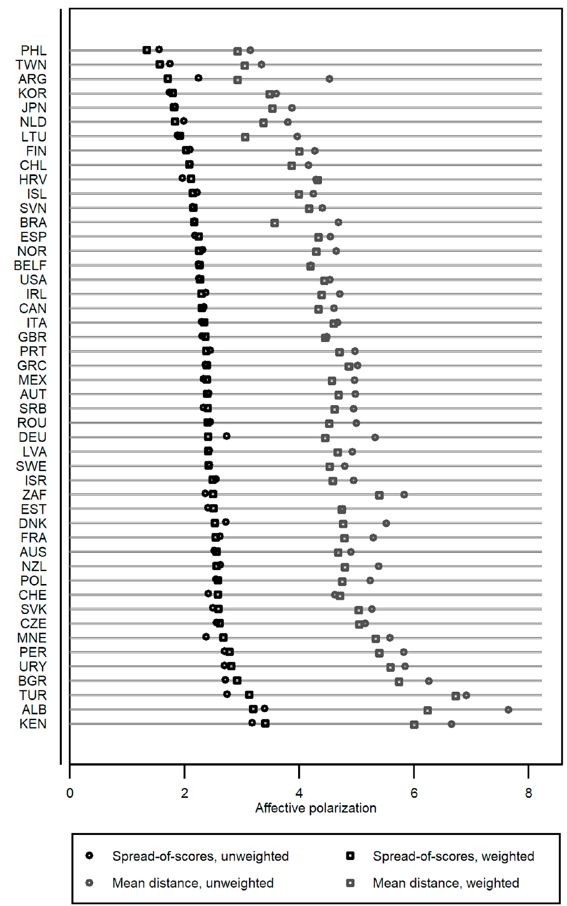
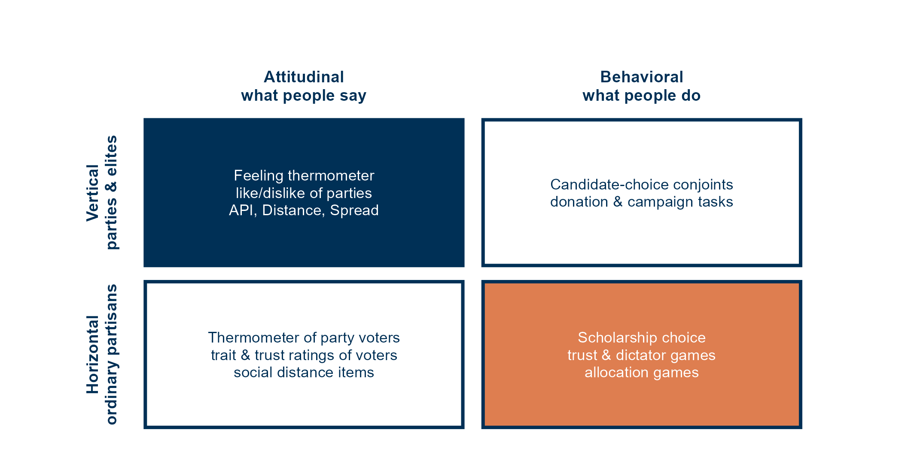

<!--
Session 05, 90 minutes. Time plan, also repeated in the notes of each section divider:

   0-5   Opening: goals, agenda
   5-20  Two parties: the thermometer, and AP at different levels
  20-42  Many parties: three measures, one respondent, weighting
  42-50  Whose AP? Population of inference
  50-67  What the thermometer captures: vertical vs horizontal
  67-72  Recap: takeaways and goals
  72-88  Your term paper
  88-90  Next session

The learning goals are copied from course.yml (weeks, week 5). The deck runs no R, so they
are kept in step by hand, like the title.
The schematics are rendered by scratch/week05-figures.R, which also recomputes every worked
number on the slides and checks the formulas against Wagner (2021), Table 1.
Figure provenance and rights are listed in images/COPYRIGHTS.md.
-->

## Session 05 goals {#sec-week05-goals}

::: notes
- read the goals aloud
- goal 1 is blocks 1 and 4, goal 2 block 2, goals 3 and 4 block 3
:::

By the end of today, you will be able to:

1. Say what a feeling thermometer measures and what it does not.
2. Reconstruct how an AP score is built in a multiparty system, and state what each step of the construction assumes.
3. Explain why the decision about who counts as a partisan changes the population an estimate refers to.
4. Judge whether a published estimate supports a comparison across countries or over time.

## Today {#sec-today .smaller}

::: notes
- 0 to 5 min: goals and agenda
- bridge from last week: we asked whether AP exists, today we ask how it is measured
:::

1. **Two parties**
   - The thermometer, and AP from one person to a country
2. **Many parties**
   - Three measures, one respondent
3. **Whose AP?**
   - The population behind the number
4. **What does the thermometer capture?**
   - Parties or people, vertical or horizontal
5. **Wrap-up**
6. **Your term paper**

# Two parties {#sec-two-party}

::: notes
- 5 to 20 min
- start from the case we know from last week: the US, two parties
:::

## The thermometer {#sec-thermometer .smaller}

::: notes
- ANES since 1978: rate each party from 0 (cold) to 100 (warm), 50 is neutral
- Europe: like/dislike scale 0 to 10, same logic
- why it dominates: one item per party, decades of data, in almost every election study
- the respondent is classified first: here a Democrat
- AP is the gap between the in-party and the out-party rating
:::

"Please rate each party on a scale from 0 to 100. Ratings above 50 mean you feel warm toward it, below 50 cold."

{#fig-thermo-us fig-align="center" height="200"}

$$
AP_i = T_{i,\text{in}} - T_{i,\text{out}} = 85 - 20 = 65
$$ {#eq-ap-individual}

::: {.callout-note .small}
**How to read it.**
Take your rating of your own party and subtract your rating of the other party.
The bigger the gap, the more polarized you are.
:::

## From one person to a country {#sec-ap-levels .smaller}

::: notes
- six fictional respondents, three of each party
- step 1: one AP score per respondent, @eq-ap-individual
- step 2: average within a group g, @eq-ap-group
- the group can be a party, the whole sample, a country in a given year
- Democrats 58.3, Republicans 66.7, sample 62.5
- ISL Figure 1 last week was exactly this: party means, by year
- ask: the sample mean weighs both parties by how many respondents they have, is that what we want?
:::

:::: {.columns}

::: {.column width="55%"}
::: {.small}
| Respondent | Party | $T_\text{Dem}$ | $T_\text{Rep}$ | $AP_i$ |
|---|---|---:|---:|---:|
| 1 | Dem | 85 | 20 | 65 |
| 2 | Dem | 70 | 40 | 30 |
| 3 | Dem | 90 | 10 | 80 |
| 4 | Rep | 15 | 80 | 65 |
| 5 | Rep | 30 | 75 | 45 |
| 6 | Rep | 5 | 95 | 90 |

: Thermometer ratings and individual AP of six fictional partisans. Each respondent's in-party rating minus their out-party rating. {#tbl-ap-six}
:::
:::

::: {.column width="45%"}
Average $AP_i$ over any group $g$:

$$
AP_g = \frac{1}{N_g} \sum_{i \in g} AP_i
$$ {#eq-ap-group}

- Democrats: $(65 + 30 + 80)/3 = 58.3$
- Republicans: $(65 + 45 + 90)/3 = 66.7$
- Sample, or country-year: $375/6 = 62.5$

::: {.callout-note .small}
**How to read it.**
Add up the AP scores of everyone in a group and divide by the number of people in it.
The group can be a party, a sample, or a country in a given year.
:::
:::

::::

## Who is *in*? {#sec-who-is-in .smaller}

::: notes
- the formula needs T_in: so somebody has to decide what the respondent's party is
- attachment: "do you think of yourself as close to a party?", with or without leaners
- vote choice: who did you vote for, or would vote for
- most-liked: whichever party gets the highest rating
- they need not agree: a leaner, a strategic voter, a non-voter
- leave it open, back to it in block 3
:::

@eq-ap-individual needs an in-party before it can be computed.
Who decides which party is the respondent's own?

- **Attachment**: the party they say they feel close to
- **Vote choice**: the party they voted for
- **Most liked**: the party they rate highest

Even with two parties, there is a conceptual choice before the arithmetic starts.

# Many parties {#sec-multiparty}

::: notes
- 20 to 42 min
- Wagner's reading, plus Reiljan's index he builds on
:::

## The problem {#sec-multiparty-problem .smaller}

::: notes
- US: one in-party, one out-party, the gap is AP
- Europe: four, seven, ten parties on the ballot and in the survey
- multiple positive identification is common (Garry), think of blocs in Sweden or Finland
- rising radical parties draw strong dislike without anyone necessarily liking another party much
- parties differ in size: disliking the CDU is not disliking a 2% party
:::

- With many parties there is no single "other party" to subtract
- People can like **more than one** party, and form blocs [@wagner2021affective]
- Dislike can grow **without** a strong in-party, for example toward a new radical party
- Parties differ in **size**

Each measure answers these questions differently.

## One respondent, four parties {#sec-four-parties .smaller}

::: notes
- the same four ratings on every slide that follows
- vote shares from Wagner's own example, Table 1
- A is the respondent's party and also their most-liked one, so all three measures can be computed
- ask before going on: is this person polarized? how much?
:::

{#fig-ratings fig-align="center" width="85%"}

- The respondent feels close to Party A
- Vote shares follow @wagner2021affective, Table 1

## Reiljan: the AP index {#sec-api .smaller}

::: notes
- @eq-api-party: the AP of party n's partisans: own party minus each out-party, weighted by out-party size
- the 1 minus V_n renormalises, so the out-party weights sum to 1
- @eq-api: the system index weighs each partisan group by its own size
- Reiljan uses partisan group means (the like/dislike matrix), so this is a party-system index
- applied to one respondent: unweighted 10 minus 14/3 = 5.33, weighted 4.25
- implicit choices:
  - in-group = declared closeness to a party, leaners included
  - only partisans get a score, non-partisans are dropped by design
  - one in-group only, B at 9 counts as an out-party
- Reiljan says so himself: "API leaves out a substantial part of the electorate" (p. 381)
:::

:::: {.columns}

::: {.column width="50%"}
{#fig-api width="100%"}

Unweighted: $10 - \frac{9+4+1}{3} = 10 - 4.67 = \mathbf{5.33}$
:::

::: {.column width="50%"}
::: {.small}
$$
AP_n = \sum_{m \neq n} (\text{Like}_n - \text{Like}_m) \frac{V_m}{1 - V_n}
$$ {#eq-api-party}

$$
API = \sum_{n} AP_n \times V_n
$$ {#eq-api}

$n$ is the in-party, $m$ an out-party, $V$ a vote share.
:::

- In-group: the party you **feel close to**
- Only **partisans** get a score
- One in-group: B counts as an out-party
:::

::::

::: {.callout-note .small}
**How to read it.**
For the supporters of each party, take how much more they like their own party than each rival, and let bigger rivals count more.
Then average these party scores, letting bigger parties count more.
:::

## Wagner: mean distance {#sec-distance .smaller}

::: notes
- same anchor as API, now defined as the most-liked party rather than the declared one
- n_p is the number of parties without the most-liked one
- the only change on the figure: the distances are squared, 1, 36, 81
- D alone contributes 81 of 118
- 6.27 vs 5.33 from the same ratings: squaring weighs the most disliked party most
- weighted 5.45 (weights renormalised over the three other parties, which is what Wagner's Table 1 implies)
- implicit choices:
  - in-group = top rating, chosen from the outcome itself
  - anyone who rates 2+ parties gets a score, partisan or not
  - still one in-group
:::

:::: {.columns}

::: {.column width="50%"}
{#fig-distance width="100%"}

Unweighted: $\sqrt{\frac{1+36+81}{3}} = \sqrt{39.3} = \mathbf{6.27}$
:::

::: {.column width="50%"}
::: {.small}
$$
\text{Distance}_i = \sqrt{\frac{\sum_{p} (\text{like}_{ip} - \text{like}_{\max,i})^2}{n_p}}
$$ {#eq-distance}

$$
\text{Distance}^{w}_i = \sqrt{\sum_{p} v_p (\text{like}_{ip} - \text{like}_{\max,i})^2}
$$ {#eq-distance-w}

$n_p$ counts the parties other than the most-liked one, $v_p$ is a vote share.
:::

- In-group: the party you **rate highest**
- **Anyone** with two ratings gets a score
- Squaring stresses the most disliked party
:::

::::

::: {.callout-note .small}
**How to read it.**
How far each other party falls below your favourite, on average, where large gaps count extra because they are squared.
The weighted version lets bigger parties count more.
:::

## Wagner: spread of scores {#sec-spread .smaller}

::: notes
- no anchor party at all: deviations from the respondent's own mean, here 6
- squared deviations 16, 9, 4, 25, sum 54, divided by 4 parties
- divide by n_p as Wagner does, which reproduces his Table 1
- (the version dividing by n minus 1 gives 4.24, that is the standard deviation used by Ward and Tavits)
- weighted: the mean itself is vote weighted, 7.45, and the spread is 3.37
- implicit choices:
  - no in-group needed
  - everyone with two ratings, including non-partisans
  - allows blocs: liking A and B, disliking C and D is fully polarized
- Wagner's preferred measure is the weighted spread
:::

:::: {.columns}

::: {.column width="50%"}
{#fig-spread width="100%"}

Unweighted: $\sqrt{\frac{16+9+4+25}{4}} = \sqrt{13.5} = \mathbf{3.67}$
:::

::: {.column width="50%"}
::: {.small}
$$
\text{Spread}_i = \sqrt{\frac{\sum_{p} (\text{like}_{ip} - \overline{\text{like}}_i)^2}{n_p}}
$$ {#eq-spread}

$$
\text{Spread}^{w}_i = \sqrt{\sum_{p} v_p (\text{like}_{ip} - \overline{\text{like}}_i)^2}
$$ {#eq-spread-w}

$$
\overline{\text{like}}_i = \sum_{p} v_p \, \text{like}_{ip}
$$ {#eq-spread-w-mean}
:::

- **No in-group** at all
- **Everyone** with two ratings gets a score
- Allows **blocs**: two liked parties against two disliked ones
:::

::::

::: {.callout-note .small}
**How to read it.**
How far your ratings scatter around your own average rating, with no party treated as yours.
The weighted version lets bigger parties count more, both in the average and in the scatter.
:::

## Why weight? {#sec-weighting .smaller}

::: notes
- the like/dislike battery lists every party side by side, as if they were equal
- they are not: Wagner's example, disliking the AfD matters less for German politics than disliking the CDU
- and if the AfD doubles its vote, the same dislike should count for more
- practical reason: surveys differ in how many small parties they list, weights damp that
- cost 1: three more choices (which election, which vote shares, renormalise or not)
- cost 2: AP moves when vote shares move, even if nobody's feelings changed
- Reiljan's Greece: Syriza went from 5 to 27%, so its weight in the index rose more than fivefold between 2009 and 2012
- ask: is that a bug or a feature?
:::

The scale shows every party as an equal line, but parties are **not** equal in size.

- **For**: disliking a 40% party says more about a system than disliking a 3% one [@wagner2021affective]
- **For**: surveys list different numbers of small parties, and weights damp that
- **Against**: more choices to make and report
- **Against**: AP changes when vote shares change, even if no feeling changes [@reiljan2020fear]

::: {.callout-note}
**Weighting answers a different question.**
Unweighted: how polarized is this person's view of all parties?
Weighted: how polarized is this person's view of the parties that matter for the system?
:::

## Same ratings, three scores {#sec-measures-summary .smaller}

::: notes
- read the table row by row
- the numbers are not even on a common scale
- the columns are the real content: each measure carries a theory of partisanship
- "AP in country X is 4.2" means nothing until you know which row produced it
:::

::: {.small}
| Measure | In-group | Who gets a score | Blocs? | Unweighted | Weighted |
|---|---|---|---|---:|---:|
| API [@reiljan2020fear] | Declared closeness | Partisans | No | 5.33 | 4.25 |
| Distance [@wagner2021affective] | Highest rating | Anyone with 2+ ratings | No | 6.27 | 5.45 |
| Spread [@wagner2021affective] | None | Anyone with 2+ ratings | Yes | 3.67 | 3.37 |

: Three AP measures computed from the same four ratings (A 10, B 9, C 4, D 1), with and without vote-share weights. Each measure makes its own assumption about who the in-group is and who gets a score. {#tbl-measures}
:::

::: {.callout-important}
**A number without its measure means nothing.**
Always state which measure, weighted or not, and who was included.
:::

## Does the choice matter? {#sec-wagner-fig1 .smaller}

::: notes
- **figure shows:** country means of AP in CSES, 51 countries, four measures
- black = spread, grey = mean distance, circles unweighted, squares weighted
- **figure means:**
  - levels differ a lot between measures: distance is always higher than spread
  - but the country ranking barely changes: correlations around .9
  - Wagner: because few voters have one strong in-party
  - the US sits mid-table, not at the top
  - associations with turnout, satisfaction with democracy hold across measures, with some differences
- so: the choice matters for levels, less for rankings, but you only know that because he computed all four
:::

:::: {.columns}

::: {.column width="45%"}
{#fig-wagner-countries height="410"}
:::

::: {.column width="55%"}
- Levels differ: distance always sits above spread
- Rankings barely move: the measures correlate at about .9
- Few voters have **one** strong in-party
- The US is average in this comparison

Check the robustness of your result across measures, and report it.
:::

::::

# Whose AP? {#sec-population}

::: notes
- 42 to 50 min
- back to the open question from block 1
:::

## Population of inference {#sec-population-inference .smaller}

::: notes
- each in-group rule defines who gets a score
- and who gets a score defines whose AP the mean describes
- API: partisans (with leaners), Distance and Spread: anyone with 2+ ratings
- Druckman and Levendusky also restrict to partisans and leaners
- "partisans in Germany are polarized" vs "Germans are polarized" are different claims
- ask: which population does your research question need?
:::

Do we want the AP of

- **partisans** (attached to a party)?
- **voters** (voted for one)?
- partisans **and** voters?
- the **whole** sample?

- The answer fixes how the in-group is coded
- And it fixes **whose** AP the estimate describes
- API: partisans only. Distance and spread: anyone who rates two parties.

## Who is in the sample? {#sec-composition .smaller}

::: notes
- **figure shows:** our own data, eu25games, 25 EU democracies, waves 2 and 3
- dark blue: attached to a party and voted for it, mid blue: attached but voted for another, light blue: attached, no vote
- red: no attachment but a vote, orange: neither, grey: don't know
- **figure means:**
  - attached share from 80% in Denmark to 32% in Latvia
  - a partisans-only AP in Latvia describes a third of the sample, in Denmark four fifths
  - Reiljan's Table 2: 74% partisans in Northwestern Europe, 58% in Central Eastern Europe, 82% in the US
- ask: if Latvian partisans look more polarized than Danish ones, what have we compared?
:::

, see @hahm2024divided. Unweighted shares of attention-check passers.](images/week05-eu25-composition.png){#fig-composition fig-align="center" height="440"}

## Say whose AP {#sec-whose-ap .smaller}

::: notes
- the same measure in two countries can describe very different shares of the public
- so a cross-national difference can be a difference in who was counted
- holds over time too: partisanship declines, the partisan pool changes
:::

::: {.callout-important}
**Be clear whose AP you study.**
Your in-group rule decides who gets a score, and so which population your estimate describes.
In a comparison across countries or over time, report the sample composition next to the estimate.
:::

- A partisans-only estimate in Latvia describes about a third of respondents, in Denmark about four in five
- A difference between them may be a difference in **who was counted**

# What does the thermometer capture? {#sec-target}

::: notes
- 50 to 67 min
- Druckman and Levendusky
:::

## Back to the definition {#sec-definition .smaller}

::: notes
- the definition from last week
- it is about people: copartisans and opposing partisans
- now look at what the item asks: how warm do you feel toward the Republican *Party*
- ISL themselves conceded: "We will not be able to clarify whether respondents were thinking of partisan voters or party leaders"
- thermometers of partisans exist too: D&L rate "party voters", the 1980 ANES asked about "Democrats" and "Republicans" (D&L, footnote 3)
- the standard item, and nearly all comparative data, targets the party
:::

> "the tendency of people identifying as \[partisans\] to view opposing partisans negatively and copartisans positively" [@iyengar2015fear, 691]

- The definition is about **people**: fellow citizens who support a party
- The *standard* thermometer asks about **parties**
- Thermometers can also target partisans, for example "Democratic Party voters" [@druckman2019we]
- Whom do respondents picture: the neighbour, or the party leader? [@druckman2019we]

## D&L (2019): design {#sec-dl-design .smaller}

::: notes
- online sample, US, December 2017, N about 2,200, preregistered
- four kinds of item: thermometer, traits, trust, social distance (friend, neighbour, in-law)
- experiment: the thermometer, trait and trust items were randomly asked about one of three targets
- held constant within a person
- social distance not varied: pilot respondents found "marrying a member of Congress" absurd
- analysis on partisans and leaners
:::

1. **Do the measures agree?** Thermometer, trait ratings, trust, social distance
2. **Whom do people picture?** Random assignment of the target:
   - "the Democratic (Republican) Party"
   - "Democratic (Republican) Party **voters**"
   - "Democratic (Republican) Party **candidates and elected officials**"

US online survey, 2017, partisans and leaners, N about 2,200

## D&L (2019): results {#sec-dl-results .smaller}

::: notes
- table 2: out-party thermometer
  - voters 28.8 degrees
  - elites 24.7 (minus 4.1)
  - party 23.4 (minus 5.4)
  - elites and party not distinguishable (p = .35)
- same pattern for traits and, more weakly, trust
- table 1: thermometer, traits and trust correlate .44 to .64 (difference scores)
- social distance correlates only .12 to .22 with them: a different manifestation
- positive note: over 80% at least somewhat comfortable with out-party friends or neighbours
:::

::: {.small}
| Target of the out-party thermometer | Mean rating |
|---|---:|
| Party voters | 28.8 |
| Candidates and elected officials | 24.7 |
| The party | 23.4 |

: Mean out-party feeling thermometer rating by randomly assigned target, US partisans and leaners, 2017. Ratings of "the party" match those of its elites, not those of its voters. *Source:* @druckman2019we, Table 2. {#tbl-dl-target}
:::

- "The party" means its **elites**
- People dislike out-party voters, and out-party elites even more
- Thermometer, traits and trust correlate well, social distance much less

## Vertical and horizontal {#sec-vertical-horizontal .smaller}

::: notes
- Areal and Harteveld name the distinction
- vertical: upward, toward parties, leaders, elites
- horizontal: sideways, toward ordinary citizens who support another party
- the definition is horizontal, the standard item is vertical
- horizontal is what social division means: would I hire one, date one, trust one
- the two need not move together
:::

- **Vertical AP**: affect toward parties and their elites
- **Horizontal AP**: affect toward ordinary citizens who support them [@areal2024verticalvshorizontal]

- The definition is horizontal
- A party thermometer is vertical, a thermometer of party voters is horizontal
- They are related, but not the same thing

::: {.callout-important}
**Be clear which AP dimension your measure captures.**
A party thermometer speaks to feelings about parties and elites.
A claim about citizens disliking each other needs a measure that targets citizens.
:::

## Where do our measures sit? {#sec-grid-empty .smaller}

::: notes
- two dimensions: target (vertical, horizontal) and mode (what people say, what people do)
- ask: place today's measures, API, Distance, Spread
- ask: and last week? ISL thermometer, ISL marriage question, IW implicit test, scholarship choice, trust and dictator games
- the BIAT is a good one to argue about: implicit, so neither said nor done, and the stimuli were party images
- 3 to 4 min in pairs, then collect
:::

{#fig-grid-empty fig-align="center" height="340"}

Place today's measures and last week's in the grid.

## The grid filled in {#sec-grid .smaller}

::: notes
- top left: everything we did today, and nearly all comparative work
- bottom left: D&L voter thermometers, ISL marriage item
- bottom right: IW scholarship and games, next week
- top right: candidate conjoints, donations
- today was the left column, mostly the top left cell
:::

{#fig-grid fig-align="center" height="340"}

Today: the **left column**. Next week: the **bottom right**.

# Wrap-up {#sec-wrap-up}

::: notes
- 67 to 72 min
:::

## Recap: takeaways {#sec-recap .smaller}

::: notes
- ask for one takeaway before revealing the list
:::

- In two-party systems, AP is the in-party minus the out-party rating, averaged over any group
- In multiparty systems, API, distance and spread give different numbers from the same ratings
- Each measure assumes who the in-group is, and who gets a score
- That choice fixes whose AP an estimate describes
- Party thermometers capture **vertical** AP, mostly feelings about elites

## Recap: learning goals {#sec-recap-goals .smaller}

::: notes
- goal by goal
- ask for each answer before revealing it
:::

**Goal 1. What a thermometer measures**

- Warmth toward parties, which respondents read as their elites, not toward fellow partisans

**Goal 2. Building an AP score with many parties**

- Pick an in-group rule (closeness, top rating, none), a distance (plain or squared), and weights (or none)

**Goal 3. Who counts as a partisan**

- The in-group rule decides who gets a score, so it decides whose AP you estimate

**Goal 4. Comparisons across countries and time**

- Only with the same measure, and with the sample composition reported

# Your term paper {#sec-term-paper}

::: notes
- 72 to 88 min
- the seminar is half done by session 6, the pitches are in sessions 11 and 12
:::

## Start now {#sec-start-now .smaller}

::: notes
- keep a list of what caught your interest in the readings so far
- look at the optional readings on the syllabus
- replication-and-extension is a real genre of published work
- tweak: a new country, a new year, another measure, another population, a new outcome
- you hand in the paper with code that reproduces it, any tool that runs from a script
:::

- Begin thinking about what interests you, and look for data and papers
- A good strategy: take an **existing empirical paper** that interests you, and **tweak it**
  - another country, period, measure, population or outcome
- That is completely fine, and it is how much published research starts

## What I expect {#sec-expectations .smaller}

::: notes
- publication-ready means: a reader in the field could follow and check every step
- the logic of the argument is what I care about most
- fractal: the paper is an argument, each section is an argument, each paragraph is an argument
:::

A paper as close to **publication-ready** as possible.
Above all, I care about the **logic of the argument**.

The magic five:

1. Introduction
2. Theory
3. Research design
4. Empirical analysis
5. Conclusion

- The whole paper is **one large argument**
- Every section, and every paragraph, is a **smaller argument** that serves it

## Sections as arguments (1) {#sec-sections-1 .smaller}

::: notes
- intro: puzzle, or importance, or both, then a sneak preview of every other section
- theory: why, given the literature and your own reasoning, things should be the way you expect
- design: why this data, this measure, this analysis can answer the question
- today was a lesson in exactly that: the measure and the population are design choices to defend
:::

**Introduction**: why your research question is interesting (puzzling), or important, or both.
Then a short overview of all other sections.

**Theory**: why, based on the literature and your own reasoning, things should be the way you expect.
Ideally: why your hypotheses follow logically from the state of research.

**Research design**: why your data, measurement and analysis are well suited to the question and the hypotheses.
Be open about what the data can and cannot do. Do not overclaim.

## Sections as arguments (2) {#sec-sections-2 .smaller}

::: notes
- analysis: the pattern is evidence for or against, and the argument is why
- limitations belong here, not hidden in the conclusion
- conclusion: recap the chain, then the contribution: what do we know now that we did not before?
- the grading scheme will follow later, it assesses all five parts
:::

**Empirical analysis**: why the patterns in your results support, or contradict, your hypotheses and interpretations.
Again, be honest about what the method can and cannot say.

**Conclusion**: a recap of the whole chain of argument, and why your study contributes to the literature.

::: {.callout-note}
**A concrete grading scheme follows later in the course.**
It will assess all five parts of this scheme.
:::

## Next session {#sec-next-session}

::: notes
- 1 min
:::

- **Session 06: Beyond the thermometer: behavioral measures**
- Today we stayed in the left column. Next we move to the bottom right.
- Core reading: @hahm2024divided and @stoetzer2023affective

## References {#sec-references .smaller .scrollable}

<!-- .scrollable is allowed here only because this is the reference slide (STYLE.md §5.1). -->

::: {#refs}
:::
