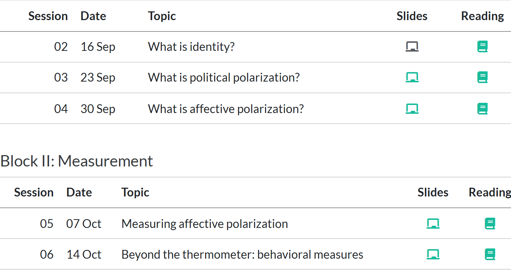
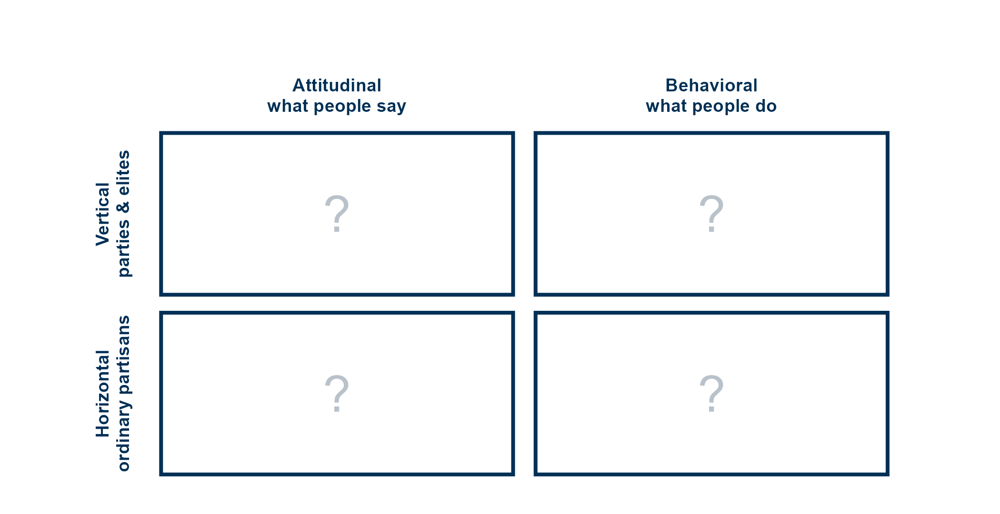
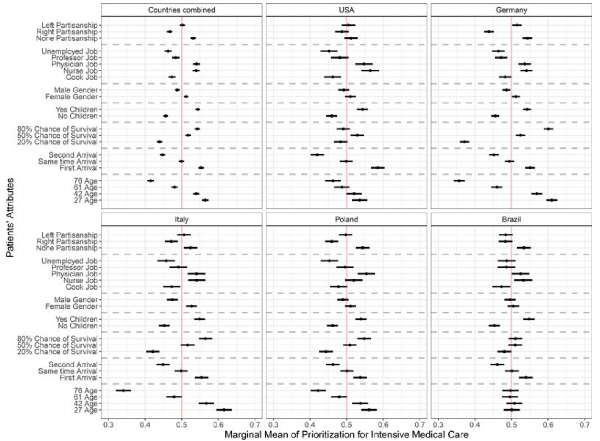
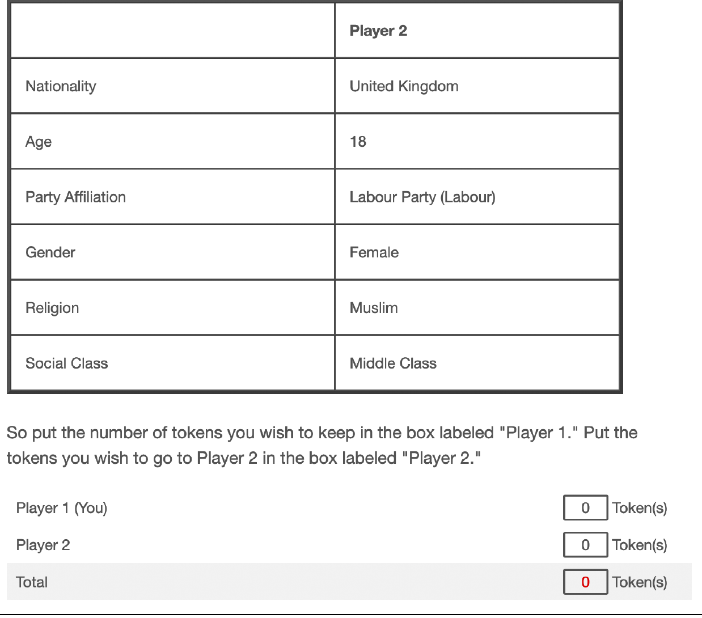
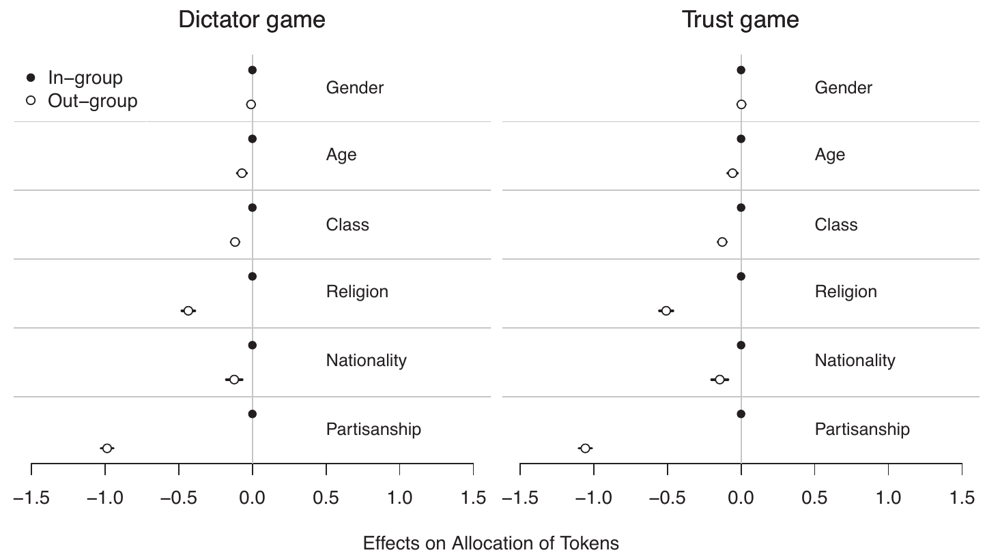

<!--
Session 06, 90 minutes. Time plan, also repeated in the notes of each section divider:

   0-3   Opening: goals, agenda
   3-7   Halfway: sessions 2 to 5, and today
   7-13  From saying to doing: the grid, what is behavior?
  13-17  Where do today's readings sit?
  17-23  Two designs side by side
  23-36  Primer: potential outcomes and randomization
  36-50  Stoetzer et al. (2023), magic five
  50-68  Hahm, Hilpert and Koenig (2024), magic five
  68-76  Internal and external validity
  76-80  Recap: takeaways and goals
  80-88  Open round: AI tools (drop or shorten if behind)
  88-90  Next session

The learning goals are copied from course.yml (weeks, week 6). The deck runs no R, so they
are kept in step by hand, like the title.
The grid, the paper crops and the schedule screenshot are rendered by
scratch/week06-figures.R, which also recomputes every number of the potential outcomes
example.
The notation follows the TBCI course notes, week 2.
Figure provenance and rights are listed in images/COPYRIGHTS.md.
-->

## Session 06 goals {#sec-week06-goals .smaller}

::: notes
- read the goals aloud
- goals 1 and 2 are the readings, goal 3 the primer, goal 4 the validity block, goal 5 Hahm et al.
:::

By the end of today, you will be able to:

1. Describe how a conjoint allocation game turns a choice into a measure of partisan animosity.
2. Compare behavioral and attitudinal measures on what each can and cannot support.
3. Explain, with potential outcomes, why only one outcome per person is observed and why random assignment still recovers the average causal effect.
4. Distinguish internal from external validity, and assess both for a given design.
5. Explain why coalition partnership changes the pattern of animosity in European party systems.

## Today {#sec-today .smaller}

::: notes
- 0 to 3 min: goals and agenda
- bridge from last week: we ended in the left column of the grid, today the right one
:::

1. **Halfway**
   - The course so far
2. **From saying to doing**
   - What counts as behavior?
3. **Two designs**
   - Where they sit, what they share, where they differ
4. **Primer: potential outcomes**
   - Why randomization recovers a cause
5. **Stoetzer et al. (2023)** and **Hahm, Hilpert and König (2024)**
6. **Internal and external validity**
7. **Wrap-up**, and an open round on AI tools

# Halfway {#sec-halfway}

::: notes
- 3 to 7 min
- block 2, Measurement, ends today
:::

## The course so far {#sec-course-so-far .smaller}

::: notes
- one line per session, read them, do not lecture them
- 4: insist on both parts, liking us and disliking them, today's papers need both
- ask: which of these would you dispute?
- next block asks whether party is the only line, and what AP does to democracy
:::

:::: {.columns}

::: {.column width="55%"}
{#fig-schedule width="100%"}
:::

::: {.column width="45%"}
::: {.small}
- **02** An identity is a demand for recognition, not a preference, and that makes it political
- **03** Polarization is a family of concepts, and many disputes are about which one is meant
- **04** AP is warmth toward one's own side **and** dislike of the other, rooted in social identity
- **05** An AP score is a construction: in-group rule, distance, weights and target all move it
- **06** Today: what people **do**
:::
:::

::::

# From saying to doing {#sec-saying-doing}

::: notes
- 7 to 13 min
:::

## The grid again {#sec-grid-again .smaller}

::: notes
- last week's grid, filled in
- the left column was last week, mostly the top left cell
- today: the right column, what people do
:::

{#fig-grid-again fig-align="center" height="340"}

Last week: the **left** column. Today: the **right** one.

## What is behavior? {#sec-what-is-behavior .smaller}

::: notes
- leave both questions open, collect answers, do not resolve
- points that tend to come up:
  - cost: giving a token to one person means not keeping it
  - trade-off: choosing one patient means not choosing the other
  - consequence: does anything follow from the answer?
  - awareness: does the respondent know what is being measured?
  - stated vs revealed: what people say they value vs what their choices show
- the survey answer is a behavior too, a cheap one, with no trade-off attached
- keep this in mind for the validity block: hypothetical tokens are cheap as well
:::

What makes something a **behavior** rather than an **attitude**?

. . .

Is answering a survey question not itself a behavior?

# Where do today's readings sit? {#sec-placing}

::: notes
- 13 to 17 min
:::

## Place the readings {#sec-place-readings .smaller}

::: notes
- 2 min in pairs
- ask: where do Stoetzer et al. and Hahm et al. go? and why?
- ask: what would you change in either design to move it to another cell?
:::

{#fig-grid-empty fig-align="center" height="340"}

Where do the two readings go?

## Both in the bottom right {#sec-placed .smaller}

::: notes
- both: the target is an ordinary person (a patient, a player), the task is a choice with a trade-off
- so both bottom right
- the same conjoint machinery moves up a row if the profile is a candidate and the question is a vote
- what moves a design between rows is the target, between columns the task
- ask: is a vote choice a behavior, if it is asked in a survey?
:::

{#fig-grid-readings fig-align="center" height="340"}

The design travels: change the **target** and you change the row.

# Two designs side by side {#sec-two-designs}

::: notes
- 17 to 23 min
:::

## What they share {#sec-share .smaller}

::: notes
- conjoint: each profile is a bundle of attributes, every attribute randomized
- party is one attribute among several nonpolitical ones, so it competes with them
- the target is a fellow citizen, horizontal AP
- hypothetical: nobody dies, no real money changes hands
- both cross-national, both publish replication data
:::

- A **conjoint** design: profiles with several attributes, each **randomly** drawn
- **Party** is one attribute among nonpolitical ones
- The profile is an **ordinary person**, not a party
- Several tasks per respondent, hypothetical stakes
- Online panels in **several countries**

## Where they differ {#sec-differ .smaller}

::: notes
- task: Stoetzer is a selection, like IW's scholarship, Hahm an allocation, like IW's games
- outcome: binary vs 0 to 10
- party levels: Stoetzer show two named parties, one left and one right, the same pair for every respondent in a country
- Hahm draw a named party at random from all parties of the country, co- or out-partisan is coded afterwards from the respondent's own party
- ask: which outcome tells you more about how much someone dislikes the out-group?
:::

Same logic, different choices about task, outcome and party.

::: {.small}
| | @stoetzer2023affective | @hahm2024divided |
|---|---|---|
| Task | Choose one of two patients for intensive care | Give 0 to 10 tokens to one player |
| Outcome | Binary: chosen or not | Integer: tokens given |
| Party shown | One named left or one named right party per country, or none | A named party, drawn at random from the country's parties, or none |
| Co- vs out-partisan | Built from respondents' ratings of the two parties | Coded afterwards from respondents' party identification |
| Estimate | Marginal means, conditional effects | Average marginal component effects |
| Scope | 5 countries, 2020, N = 6,415 | 25 countries, 2019, N = 29,827 |

: The two designs compared. Both randomize the profile attributes, but they differ in the task, the outcome, and how partisanship is shown and coded. {#tbl-differ}
:::

# Primer: potential outcomes {#sec-causal}

::: notes
- 23 to 36 min
- one running example, from Hahm et al.
- only the foundation: no tests, no p-values
:::

## The causal question {#sec-causal-question .smaller}

::: notes
- the question in Hahm et al., stated as a causal claim
- a cause is a comparison of two worlds for the same person: this player as an out-partisan, and the same player as a co-partisan
- ask first: how would you answer this with a survey you already have, say the ESS?
- (they will say: compare people, which is exactly the problem)
:::

> Does learning that player 2 supports **another** party *cause* you to give fewer tokens?

- A cause compares **two worlds** for the **same** person
- World 1: player 2 is an **out-partisan**
- World 0: the same player 2 is a **co-partisan**

## Potential outcomes {#sec-potential-outcomes .smaller}

::: notes
- T for treatment: 1 out-partisan, 0 co-partisan
- each person carries two potential outcomes, before anything happens
- tau_i is the effect for one person, the SATE averages it over the sample
- "would": the potential outcomes are counterfactual, defined whether or not we see them
:::

- $T_i = 1$: respondent $i$ meets an **out-partisan** (treatment)
- $T_i = 0$: respondent $i$ meets a **co-partisan** (control)
- $Y_i(1)$, $Y_i(0)$: tokens $i$ **would** give in each case

$$
\tau_i = Y_i(1) - Y_i(0)
$$ {#eq-tau-i}

$$
\tau = \frac{1}{N} \sum_{i=1}^{N} \left[ Y_i(1) - Y_i(0) \right]
$$ {#eq-sate}

::: {.callout-note .small}
**How to read it.**
$\tau_i$ is how many tokens fewer person $i$ gives because player 2 is an out-partisan.
$\tau$, the sample average treatment effect (SATE), is that difference averaged over everyone.
:::

## The complete data table {#sec-complete-table .smaller}

::: notes
- four fictional respondents, both potential outcomes visible, as if we were omniscient
- effects differ: respondent 2 does not discriminate at all, 1 and 4 by 3 tokens
- SATE: -2 tokens
- this is the table we would need to know a causal effect
- ask: where would such a table come from?
:::

Suppose we could see both worlds for everyone.

::: {.small}
| $i$ | $Y_i(1)$ | $Y_i(0)$ | $\tau_i$ |
|:---:|:---:|:---:|:---:|
| 1 | 2 | 5 | $-3$ |
| 2 | 4 | 4 | $0$ |
| 3 | 1 | 3 | $-2$ |
| 4 | 5 | 8 | $-3$ |
| **Average** | **3** | **5** | $\mathbf{-2}$ |

: The complete data table for four fictional respondents: the tokens each would give an out-partisan, $Y_i(1)$, and a co-partisan, $Y_i(0)$, and the individual effect $\tau_i$. The sample average treatment effect is $-2$ tokens. {#tbl-complete}
:::

With both columns, the causal effect is simple arithmetic.

## The fundamental problem {#sec-fundamental-problem .smaller}

::: notes
- now reality: each respondent meets one player 2, so one world only
- here respondents 1 and 3 met an out-partisan
- consistency: the observed outcome is the potential outcome of the world that happened
- half the table is missing, and it is always the half we need
- causal inference is a missing data problem
:::

In reality, each respondent meets **one** player 2.

:::: {.columns}

::: {.column width="55%"}
::: {.small}
| $i$ | $Y_i(1)$ | $Y_i(0)$ | $\tau_i$ | $T_i$ | $Y_i$ |
|:---:|:---:|:---:|:---:|:---:|:---:|
| 1 | 2 | ? | ? | 1 | 2 |
| 2 | ? | 4 | ? | 0 | 4 |
| 3 | 1 | ? | ? | 1 | 1 |
| 4 | ? | 8 | ? | 0 | 8 |

: The same four respondents as observed. Respondents 1 and 3 met an out-partisan, 2 and 4 a co-partisan. For each person one potential outcome is seen and the other is missing, so no individual effect can be computed. {#tbl-observed}
:::
:::

::: {.column width="45%"}
The observed outcome is the potential outcome of the world that happened:

::: {.small}
$$
Y_i = Y_i(1)\,T_i + Y_i(0)\,(1 - T_i)
$$ {#eq-consistency}
:::
:::

::::

::: {.callout-important .small}
**The fundamental problem of causal inference: we never see both potential outcomes of the same person.**
So no individual effect $\tau_i$ is ever observed.
:::

## Comparing groups {#sec-groups .smaller}

::: notes
- give up on individuals, compare groups
- observed assignment, respondents 1 and 3 treated: 1.5 minus 6 = -4.5, true -2
- selection: now suppose only respondents 2 and 4 met out-partisans
  - they are the generous ones, they give more whatever happens
  - in real life: people with out-party friends are the ones who meet out-partisans
  - then 4.5 minus 4 = +0.5, the wrong sign
- ask: who meets out-partisans in real life?
:::

Compare the **groups** instead, with the difference in means:

$$
\hat\tau = \bar{Y}_{T} - \bar{Y}_{C}
$$ {#eq-dim}

- Respondents 1 and 3 treated: $\frac{2+1}{2} - \frac{4+8}{2} = 1.5 - 6 = -4.5$

. . .

- If only the generous ones, 2 and 4, had met out-partisans: $\frac{4+5}{2} - \frac{5+3}{2} = 4.5 - 4 = +0.5$

::: {.callout-warning .small}
**When who is treated depends on the potential outcomes, the comparison is biased.**
Here selection even flips the sign of the effect.
:::

## Why randomization works {#sec-randomization .smaller}

::: notes
- a coin decides who meets an out-partisan, so the coin cannot know anyone's potential outcomes
- the treated are a random draw from the Y(1) column, the controls from the Y(0) column
- so each group mean estimates its column mean
- all six ways to treat two of four: -2.5, -4.5, 0, -4, +0.5, -1.5
- their mean is exactly -2, the SATE
- one draw is noisy, the procedure is right on average, larger samples shrink the noise
- it balances everything, observed and unobserved: class, religion, ideology, generosity
- no control variable can promise that
:::

- A **coin** decides $T_i$, so treatment is unrelated to $Y_i(1)$ and $Y_i(0)$
- The treated are a random draw from the $Y_i(1)$ column, the controls from the $Y_i(0)$ column
- So $\bar{Y}_T$ estimates the average of $Y_i(1)$, and $\bar{Y}_C$ that of $Y_i(0)$

. . .

::: {.small}
| Treated | 1, 2 | 1, 3 | 1, 4 | 2, 3 | 2, 4 | 3, 4 | Average |
|---|:---:|:---:|:---:|:---:|:---:|:---:|:---:|
| $\hat\tau$ | $-2.5$ | $-4.5$ | $0$ | $-4$ | $+0.5$ | $-1.5$ | $\mathbf{-2}$ |

: The difference in means under each of the six ways to treat two of the four respondents. Single estimates scatter, but their average equals the true effect of $-2$. {#tbl-assignments}
:::

Any single draw is noisy. **On average**, randomization gets it right.

## From one coin to a conjoint {#sec-conjoint-coins .smaller}

::: notes
- a conjoint flips one coin per attribute
- so each attribute has its own treatment and control comparison
- AMCE: the difference in means for one attribute, averaged over the other attributes as they were randomized
- Hahm's headline -0.99 tokens is tau hat for "out-partisan vs co-partisan"
- Stoetzer's marginal means are the group means, Y bar, for each level
- the important box is the hook for the validity block
:::

- A conjoint flips **one coin per attribute**: party, religion, class, age, ...
- Each attribute gets its own treatment and control comparison
- **AMCE**: the difference in means for one attribute, averaged over all the others [@hainmueller2014causal]
- Hahm et al.: an out-partisan player 2 gets $\hat\tau = -0.99$ tokens

::: {.callout-important}
**Randomization identifies the effect of what was randomized, and nothing else.**
Anything measured rather than assigned is back to a comparison of groups.
:::

# Stoetzer et al. (2023) {#sec-stoetzer}

::: notes
- 36 to 50 min
- the magic five from last week's term paper section, now as a reading tool
- a research note: short, so the parts are short
:::

## Introduction {#sec-st-intro .smaller}

::: notes
- RQ: does partisan dislike go so far as to deny fundamental rights?
- AP already reaches dating, hiring, health
- the extreme end, life and death, is hard to observe
- COVID made triage a public debate everywhere
- least likely case: medical guidelines are utilitarian, partisanship should not matter at all
- ask: why is a least likely case convincing, and what would a failure have shown?
:::

- Does partisan dislike go so far as to deny **fundamental rights**?
- AP reaches dating, hiring and health, but extreme consequences are hard to observe
- COVID-19 made **triage** a public question in every country
- A **least likely case**: guidelines say only medical criteria count

## Theory {#sec-st-theory .smaller}

::: notes
- very thin: two paragraphs of social identity theory
- expectation: patient partisanship matters, and more so among the affectively polarized
- hypotheses preregistered in a pre-analysis plan
- ask: where is the theory section? is a research note allowed to skip it?
- ask: what would a full theory section have to explain?
:::

- Partisan identity triggers **in-group favouritism** and **out-group hostility** [@iyengar2012affect]
- That logic can extend beyond politics
- Expectation: the patient's party matters, most of all to the affectively polarized
- Hypotheses preregistered

Where is the theory section?

## Research design {#sec-st-design .smaller}

::: notes
- Brazil, Germany, Italy, Poland, US, August 2020, N 6,415, quota online panel
- four pairs per respondent, attributes randomized, order fixed per respondent
- party: a named left and a named right party, or none
  - DE Greens and AfD, PL PO and PiS, BR PT and PSL, IT Italia Viva and Lega, US Democrat and Republican
- polarization measured by the 0 to 10 rating gap between the left and the right party, cut at -5 and +5
- note: the youngest age reads 21 in the design, 26 in the results and 27 in Figure 1, the paper is inconsistent
:::

:::: {.columns}

::: {.column width="50%"}
::: {.small}
| | Patient A | Patient B |
|---|---|---|
| Age | 42 | 76 |
| Gender | Female | Male |
| Children | Yes | No |
| Occupation | Nurse | Cook |
| Arrival | First | Second |
| Survival chance | 50% | 80% |
| Partisanship | AfD | None |

: An illustrative profile pair in the German version, drawn up for this slide, not taken from the paper. Respondents chose which patient should get intensive care. {#tbl-st-profiles}
:::
:::

::: {.column width="50%"}
- Brazil, Germany, Italy, Poland, US, August 2020
- N = 6,415, four pairs each
- Party: a named **left** or **right** party, or none
- Who is polarized: the gap in ratings of the two parties
:::

::::

## Results: triage criteria {#sec-st-results-mm .smaller}

::: notes
- **figure shows:** marginal means, the share of times a patient with each level is chosen, 50% is no effect
  - pooled and by country
- **figure means:** people mostly follow the guidelines
  - survival 80% chosen 54% vs 20% chosen 44%
  - age 76 chosen 41%
  - children 54 vs 45, arriving second 45%
  - partisanship: none 53, left 50, right 46
  - AfD patient 43% in Germany, nothing in the US
:::

:::: {.columns}

::: {.column width="55%"}
{#fig-st-mm height="430"}
:::

::: {.column width="45%"}
- Choices mostly follow the **guidelines**: survival, age, children
- Partisanship matters **less** on average
- No party: 53%, left: 50%, right: 46%
- AfD patients: 43% in Germany
:::

::::

## Results: who discriminates {#sec-st-results-amcie .smaller}

::: notes
- **figure shows:** effect of the patient's party, compared with no party, for respondents grouped by their rating gap
  - top row in each panel: left-polarized, middle, bottom: right-polarized
- **figure means:**
  - left-polarized: right-party patients -16 pp, left-party patients no bonus
  - right-polarized: left-party patients -5 pp, right-party patients +5 pp, in-group favouritism
  - middle: both partisans slightly below independents
  - DE, PL, BR: left-polarized penalize right patients by 15 to 20 pp
- ask: why might the left penalize more? is AfD vs Greens a symmetric pair?
- ask: is the respondent's rating gap randomized? (no, keep it for the validity block)
:::

:::: {.columns}

::: {.column width="55%"}
{#fig-st-amcie height="405"}
:::

::: {.column width="45%"}
- Left-polarized: right-party patients **$-16$ pp**
- Right-polarized: left-party $-5$ pp, right-party $+5$ pp
- Hostility **and** favouritism, in different camps

Why might the left penalize more?
:::

::::

## Saying and doing {#sec-st-saying-doing .smaller}

::: notes
- open question: what should matter for triage?
- only 1 to 2.5% name partisanship
- but choices move with it
- the moderator is a thermometer gap, the very measure we wanted to go beyond
- ask: which would you report as the respondent's real view?
:::

- Asked openly what *should* matter, only **1 to 2.5%** name partisanship
- Yet the choices move with the patient's party

. . .

Which of the two is the respondent's real view?

## Conclusion {#sec-st-conclusion .smaller}

::: notes
- AP has nonpolitical consequences, beyond the US
- strongest in Poland and Germany
- cannot separate party from beliefs about the patient's compliance with COVID rules
- suggestive: PiS backed lockdowns, AfD opposed them, both penalized alike
- no claim about real hospitals, staff do not know patients' party
:::

- Partisanship reaches a **life and death** choice, in most of the five countries
- The party cue may carry beliefs about **compliance** with COVID rules
- No claim about real hospitals: this is about moral judgement

# Hahm, Hilpert and König (2024) {#sec-hahm}

::: notes
- 50 to 68 min
- same five parts, an APSR article, so denser
- last week's eu25games composition figure came from this project
:::

## Introduction {#sec-hh-intro .smaller}

::: notes
- RQ in three parts: how strong, love or hate, does cooperation matter
- why: partyism is a US claim, does it hold in Europe with its old cleavages?
- observational data cannot separate party from the identities it proxies, class, religion
- thermometers ask about parties, not citizens: vertical, last week
:::

1. How strong is the **partisan** divide next to class, religion and nationality?
2. Is it driven by **in-group favouritism** or **out-group derogation**?
3. Does **coalition partnership** soften it?

- Partyism is a US finding, Europe has old social cleavages
- Observational data cannot separate party from the identities it proxies
- Thermometers ask about **parties**, not fellow citizens

## Theory {#sec-hh-theory .smaller}

::: notes
- H1: European parties are built on cleavages, so partisanship bundles class and religion and should dominate
- H2: in-group love does not need out-group hate (Brewer), consensus politics is "kinder, gentler" (Lijphart)
- H3: governing together creates a superordinate identity, partners look more similar
- ask: which hypothesis is the newest, and which is the riskiest?
:::

One hypothesis for each part of the question.

::: {.small}
| | Expectation | Mechanism |
|---|---|---|
| H1 | Party outweighs other divides | Parties built on long-standing social cleavages |
| H2 | Not mainly out-group derogation | In-group love without hate, consensus politics |
| H3 | Coalition partners are treated better | A shared, superordinate identity |

: The three hypotheses of @hahm2024divided and the mechanism behind each. {#tbl-hh-hypotheses}
:::

## Research design {#sec-hh-design .smaller}

::: notes
- dictator and trust games, as in IW, week 4
  - dictator: give tokens, player 2 just keeps them
  - trust: tokens tripled, player 2 may send some back
- hypothetical tokens, no real money
- three rounds of each, a new random profile every round
- six attributes randomized, foreigners shown without party
- a control with no party information separates favouritism from derogation
- 25 EU countries, May to August 2019, about 1,200 per country
:::

:::: {.columns}

::: {.column width="55%"}
{#fig-hh-profile height="400"}
:::

::: {.column width="45%"}
- **Dictator** and **trust** games, 10 hypothetical tokens
- 3 + 3 rounds, a new random profile each
- Six attributes randomized
- A control with **no party** shown
- 25 countries, 2019, N = 29,827
:::

::::

## Results: party first {#sec-hh-results-h1 .smaller}

::: notes
- **figure shows:** AMCE of the out-group level of each attribute, in tokens, against the in-group, dictator left, trust right
- **figure means:**
  - out-partisans get about one token less: -0.99 dictator, -1.06 trust
  - about 25% of the 3.92 tokens an all-in-group player gets
  - religion second, about half that: -0.43 and -0.51
  - class and nationality about -0.12, gender nothing
  - holds in all 25 countries, from 0.57 in Ireland to 1.50 in Hungary (Figure 3, not shown)
- H1 confirmed
:::

:::: {.columns}

::: {.column width="55%"}
{#fig-hh-amce width="100%"}
:::

::: {.column width="45%"}
- Out-partisans: **about one token less**, a quarter of the baseline
- Religion second, at half that
- Class, nationality small, gender none
- In **all 25** countries
:::

::::

## Results: love or hate? {#sec-hh-results-h2 .smaller}

::: notes
- **figure shows:** top, effects against the no-party control, bottom, the absolute sizes compared
- **figure means:**
  - co-partisans +0.52 dictator, +0.60 trust
  - out-partisans -0.47 and -0.45
  - difference 0.06 (n.s.) dictator, 0.15 trust: favouritism at least as large
  - indistinguishable in 23 of 25 countries (dictator)
- contrast: IW, week 4, found hostility outweighed favouritism in the US
- ask: is it the country, the party system, or the design (a randomly drawn named party, hypothetical tokens)?
:::

:::: {.columns}

::: {.column width="55%"}
{#fig-hh-love-hate width="100%"}
:::

::: {.column width="45%"}
- Co-partisans: **$+0.5$** tokens, out-partisans: **$-0.5$**
- Favouritism at least as large as derogation
- In the US, @iyengar2015fear found the reverse

Country, party system, or design?
:::

::::

## Results: coalition partners {#sec-hh-results-h3 .smaller}

::: notes
- **figure shows:** predicted tokens, with and without current coalition partnership, co-partisans and out-partisans, both games
- **figure means:**
  - out-partisan whose party governs with yours: 3.43 to 3.72 tokens
  - co-partisan when your party is in a coalition: 4.67 to 4.48
  - so the gap shrinks from both ends
  - years of coalition experience: out-partisans 3.39 to 4.02
  - district magnitude, number of parties, elite polarization: no effect
- ask: what else differs between a party you govern with and one you do not?
- (ideology, size, history: coalition status is not randomized)
:::

{#fig-hh-coalition fig-align="center" width="85%"}

- Coalition partners get more ($3.43 \rightarrow 3.72$), co-partisans less ($4.67 \rightarrow 4.48$)
- Institutions such as district magnitude or the number of parties: **no** effect

## Conclusion {#sec-hh-conclusion .smaller}

::: notes
- partyism travels to Europe
- Europe's AP is not mainly hate
- what parties do to each other matters more than fixed institutions
- caveat: no ethnicity attribute, hard to define across 25 countries
- ask: if you could add one attribute to the profile, which?
:::

- The **primacy of partyism** holds across Europe
- European AP is favouritism **and** derogation in equal parts
- How parties **treat each other** matters, institutions do not
- Caveat: no ethnicity attribute

Which attribute would you add?

# Internal and external validity {#sec-validity}

::: notes
- 68 to 76 min
:::

## Back to the primer {#sec-back-to-primer .smaller}

::: notes
- randomization buys an unbiased estimate of the SATE
- for what was randomized, for these respondents, in this task
- two questions follow: does that hold here, and is it the effect we care about?
:::

- Randomization makes $\hat\tau$ a good estimate of $\tau$
- For **what was randomized**, for **these** respondents, in **this** task

. . .

- Does that hold here? **Internal** validity
- Is this $\tau$ the one we care about? **External** validity

## Two kinds of validity {#sec-two-validities .smaller}

::: notes
- internal: threats are anything that breaks the comparison: selection, non-randomized moderators, bundled treatments
- external: other people, real stakes, other countries, other years
- the trade-off: the cleaner the task, the further it can be from life
:::

**Internal validity**: does the design identify the causal effect, for these people, in this task?

**External validity**: does the effect hold for other people, real stakes, other places and times?

::: {.callout-note}
**The two often pull apart.**
A clean, simple task makes the comparison credible.
The same simplicity can take it far from the situations we care about.
:::

## Your turn {#sec-validity-turn .smaller}

::: notes
- 3 min in pairs, then collect
- internal, strong: the party attribute is randomized in both
- internal, weaker:
  - Stoetzer: the respondent's AP is measured, not assigned
  - Stoetzer: "right party" bundles different parties, AfD and PiS, and COVID compliance
  - Hahm: coalition status belongs to the randomly drawn party, so it travels with ideology, size, history
  - so H1 is more credible than H3
- external:
  - hypothetical patients and tokens, cheap choices
  - online panels, quota samples
  - 2019 vs pandemic 2020
  - 25 countries is external validity by design, 5 countries less so
:::

In pairs, three minutes.

::: {.small}
| | Internal validity | External validity |
|---|---|---|
| @stoetzer2023affective | | |
| @hahm2024divided | | |

: Strengths and threats to fill in for each paper. {#tbl-validity-turn}
:::

- What is randomized, and what is only measured?
- Whom, which stakes, and which years do the results speak to?

## Open questions {#sec-validity-open .smaller}

::: notes
- no answers on the slide, take two or three voices per question
- link back to the first question of the session: what is behavior?
:::

- Is a hypothetical token a behavior?
- Would you trust 25 countries of hypothetical tokens, or one lab with real money?
- If a thermometer and a game disagree, which one is AP?

# Wrap-up {#sec-wrap-up}

::: notes
- 76 to 80 min
:::

## Recap: takeaways {#sec-recap .smaller}

::: notes
- ask for one takeaway before revealing the list
:::

- Behavioral measures ask people to **choose**, with a trade-off, and target ordinary people
- Both readings randomize profiles, but differ in task, outcome and how party is coded
- Only one potential outcome per person is observed, randomization still recovers the **average** effect
- Across 25 countries party beats every other divide, and favouritism matches derogation
- What is randomized has strong internal validity, what is only measured does not

## Recap: learning goals {#sec-recap-goals .smaller}

::: notes
- goal by goal
- ask for each answer before revealing it
:::

::: {.small}
**Goal 1. A conjoint allocation game**

- Randomize the profile, let people give tokens, and read the effect of party off the difference in means

**Goal 2. Behavioral and attitudinal measures**

- Behavior adds trade-offs and a horizontal target, but hypothetical choices remain cheap

**Goal 3. Potential outcomes**

- We see $Y_i(1)$ or $Y_i(0)$, never both, but random groups estimate each column's average

**Goal 4. Internal and external validity**

- Internal: is the comparison clean? External: does it travel? Assess both, separately

**Goal 5. Coalition partnership**

- Partners share a superordinate identity, so their supporters favour their own less and the partner more
:::

# Open round {#sec-ai-round}

::: notes
- 80 to 88 min, drop or shorten if past minute 82
:::

## How do you use AI tools? {#sec-ai-tools .smaller}

::: notes
- no slides with answers, just collect
- the syllabus AI policy is marked a first proposal, so this feeds it
- note who uses what for the term paper: literature, reading, writing, code
:::

- Which tools do you use?
- For what: finding literature, reading, writing, code?
- Where has one misled you?
- What should the rule for the term paper say?

## Next session {#sec-next-session}

::: notes
- 1 min
- bridge: Hahm et al. already set party against religion and class
:::

- **Session 07: Beyond party: social sorting and non-partisan identities**
- Today party beat religion and class. Next: what happens when they line up?
- Core reading: @harteveld2021ticking and @hobolt2020divided

## References {#sec-references .smaller .scrollable}

<!-- .scrollable is allowed here only because this is the reference slide (STYLE.md §5.1). -->

::: {#refs}
:::
