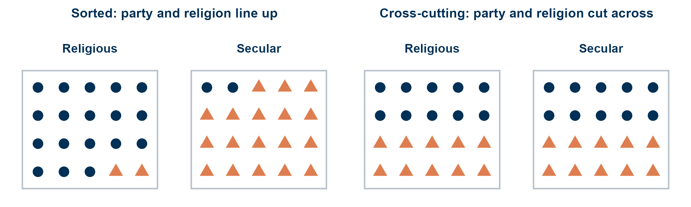

<!--
Session 07, 90 minutes. Time plan, also repeated in the notes of each section divider:

   0-3   Opening: goals, agenda
   3-6   Where we are: is party special?
         PART 1: NON-PARTISAN IDENTITIES
   6-11  From partisans to groups
  11-21  Group exercise 1 (groups of four, 10 min)
  21-28  Exchange and discussion
  28-43  Hobolt, Leeper and Tilley (2020), magic five
         PART 2: MULTIPLE IDENTITIES
  43-51  Group exercise 2 (groups of four, 8 min)
  51-57  Exchange and discussion
  57-64  Social identity complexity (Roccas and Brewer 2002)
  64-83  Harteveld (2021), magic five, methods emphasis
  83-88  Recap: takeaways and goals
  88-90  Next session

The learning goals are copied from course.yml (weeks, week 7). The deck runs no R, so they
are kept in step by hand, like the title.
The paper crops and the two schematics are rendered by scratch/week07-figures.R.
Figure provenance and rights are listed in images/COPYRIGHTS.md.
-->

## Session 07 goals {#sec-week07-goals .smaller}

::: notes
- read the goals aloud
- goal 1 and 3: Harteveld, goal 2: Hobolt et al., goal 4: Roccas and Brewer
:::

By the end of today, you will be able to:

1. Define social sorting and explain why an aligned cleavage structure raises out-group animus.
2. Give a case in which the polarizing identity is not partisan at all, and say what makes it behave like one.
3. Assess how much support the evidence gives the claim that cross-cutting identities dampen animus.
4. Describe the four ways multiple group identities can be represented (intersection, dominance, compartmentalization, merger), and explain why a more complex social identity should lower out-group bias.

## Today {#sec-today .smaller}

::: notes
- 0 to 3 min: goals and agenda
- two parts, each opens with a group exercise
:::

1. **Part 1: Groups beyond party**
   - From partisans to groups
   - Group exercise
   - @hobolt2020divided
2. **Part 2: Many identities at once**
   - Group exercise
   - Social identity complexity [@roccas2002social]
   - @harteveld2021ticking
3. **Wrap-up**

## Where we are {#sec-where-we-are .smaller}

::: notes
- 3 to 6 min
- week 4: the definition was about partisans
- week 6: party beat religion, class and nationality in 25 countries
- today's block opens the extensions: is party special?
:::

- Session 04: AP as warmth toward **co-partisans** and dislike of **opposing partisans**
- Session 06: across 25 countries, party beat religion, class and nationality
- The block that starts today pushes on the concept

. . .

Is party special, or one group among many?

# Part 1: Groups beyond party {#sec-part1}

::: notes
- 6 to 11 min
:::

## Where AP started {#sec-start-definition .smaller}

::: notes
- read the quote
- every word in it is partisan: identify, Republicans, Democrats, partisans
- ask: which part of the quote would you need to change for another group?
:::

> "the tendency of people identifying as Republicans or Democrats to view opposing partisans negatively and copartisans positively"
>
> @iyengar2015fear [691]

- Two components: liking **us** and disliking **them**
- Both defined by **party**

## Not a partisan mechanism {#sec-not-partisan .smaller}

::: notes
- social identity theory, week 4: categorization, identification, comparison
- none of the three steps needs a party
- so the general version: AP between any two groups that politics divides
- keep both components, always: in-group liking **and** out-group dislike
- the open question is when a group divide turns affective
:::

Social identity theory asks for three steps [@tajfel1986integrative]:

1. **Categorization**: us and them
2. **Identification**: I am one of us
3. **Comparison**: we are better than them

. . .

::: {.callout-important}
**Generalised, AP is in-group liking and out-group dislike between social groups that politics divides.**
Party is one such group.
Religion, region, language or a referendum camp can be others.
:::

## Group exercise {#sec-exercise1 .smaller}

::: notes
- 11 to 21 min
- groups of four, 10 min, one person notes
- make sure every group has at least one person from another country, if possible
- warn at 8 min
:::

In groups of four, ten minutes.

1. Which **social divides** could show affective polarization?
   - Which are **general** across established democracies?
   - Which are **context specific**?
2. Your **home country**: what are the dominant (perceived) divides?
3. What makes group conflict **salient**? When does AP arise, and when does it stay low?

## Exchange {#sec-exchange1 .smaller}

::: notes
- 21 to 28 min
- one divide per group, write on the board, sort into two columns
- general, likely: religion vs secular, class, education, urban vs rural, age, migration background, centre vs periphery
- context specific, likely: language (Belgium, Canada), ethnicity, secession (Catalonia, Scotland), caste, a dictatorship's legacy, a referendum (Brexit)
- conditions, likely:
  - a forced binary choice (referendum, run-off)
  - a label to identify with
  - elites who mobilize the divide
  - the divide lines up with others (part 2)
  - high stakes, threat, little contact across the line
- bridge: a referendum forces a side and hands out the labels, which is Hobolt et al.
:::

:::: {.columns}

::: {.column width="33%"}
**General divides**
:::

::: {.column width="33%"}
**Context specific divides**
:::

::: {.column width="33%"}
**When does AP arise?**
:::

::::

# Hobolt, Leeper and Tilley (2020) {#sec-hobolt}

::: notes
- 28 to 43 min
- the magic five again, as a reading tool
:::

## Introduction {#sec-hlt-intro .smaller}

::: notes
- RQ: is AP limited to partisanship?
- puzzle: Europe was not salient before 2016, under 10% named it a top issue in 2015
- labels: "Leave" and "Remain" were set by the Electoral Commission in September 2015
- before that the question was a yes or no
- so a test of whether a political event can create an identity fast
:::

- Is affective polarization limited to **partisanship**?
- The 2016 EU referendum: Europe was a minor issue before it, under 10% in 2015
- No labels for the two sides **before** the campaign
- Can one event create identities that polarize like parties?

## Theory {#sec-hlt-theory .smaller}

::: notes
- opinion-based group: sharing an opinion is not enough, it has to become part of who you are
- such groups crystallize when people are forced to take sides
- three necessary components, each one a step of social identity theory
- ask: which of the three did Iyengar and Westwood measure?
:::

**Opinion-based groups**: a shared opinion becomes the basis of a social identity.
They form when people are compelled to take sides.

::: {.small}
| Component | What it means | Evidence used |
|---|---|---|
| Identification | I see myself as a Leaver or a Remainer | Share with an identity, attachment scale |
| Differentiation | We are good, they are bad | Trait ratings, social distance |
| Evaluative bias | The identity colours judgement | Economic perceptions, conjoint choices |

: The three components of affective polarization along opinion-based lines in @hobolt2020divided, and the evidence the paper uses for each. {#tbl-hlt-components}
:::

## Research design {#sec-hlt-design .smaller}

::: notes
- many data sources, no single survey carries the paper
- all online quota panels, weighted to the British population
- party identity always measured alongside, so the two can be compared on the same scale
- the measures are week 4 to 6: identity scale, traits, social distance, conjoint
:::

::: {.small}
| Source | When | Used for |
|---|---|---|
| British Election Study panel | 2016 to 2019, about 30,000 per wave | Prevalence and stability of identities |
| YouGov and Sky surveys | 2017 to 2019 | Attachment, traits, social distance, economy |
| Two YouGov conjoints | October 2017, about 1,650 each | Choosing a BBC director-general and a lodger |

: The data behind @hobolt2020divided. All come from online quota panels weighted to the British population. {#tbl-hlt-data}
:::

- Every measure is taken for **party** and **Brexit** identity side by side
- The measures are familiar from sessions 4 to 6

## Results: identification {#sec-hlt-identification .smaller}

::: notes
- about three quarters see themselves as Leaver or Remainer, the same as party ID (74%)
- attachment scale, 1 to 5, five items like "criticism of my side feels like a personal insult"
- Sky: 3.4 for both Brexit sides, 2.9 and 3.0 for the two parties
- stable from 2016 to 2019, like partisanship
- only 35% of Leavers are Conservative, 36% of Remainers Labour
:::

- About **75%** call themselves a Leaver or a Remainer, as many as hold a party identity
- Attachment slightly **stronger** than to a party: 3.4 against 2.9 to 3.0, on a 1 to 5 scale
- Stable from 2016 to 2019
- Only 35% of Leavers are Conservatives, only 36% of Remainers Labour

. . .

Brexit identities **cut across** party lines.

## Results: differentiation {#sec-hlt-differentiation .smaller}

::: notes
- **figure shows:** mean agreement, 1 to 5, that a trait describes a side, by the respondent's own identity
- top row party, bottom row Brexit
- **figure means:** the mirror image, in both rows
  - Remainers on Remainers: positive 3.9, negative 1.9
  - Remainers on Leavers: positive 2.4, negative 3.6
- regressions in the appendix: Brexit identity, not party, drives the ratings
- table: only a third happy with a child marrying across the Brexit line
:::

:::: {.columns}

::: {.column width="55%"}
{#fig-hlt-traits height="400"}
:::

::: {.column width="45%"}
::: {.small}
| Happy with a child marrying the other side | |
|---|:---:|
| Conservatives | 24% |
| Labour | 19% |
| Leavers | 45% |
| Remainers | 30% |

: Share happy with a son- or daughter-in-law from the other side, YouGov, September 2017. *Source:* @hobolt2020divided, Table 3. {#tbl-hlt-marry}
:::

- The **same** mirror image for party and Brexit
:::

::::

## Results: evaluative bias {#sec-hlt-bias .smaller}

::: notes
- economy: Leavers +0.24, Remainers -0.49 on 1 to 5, party held constant, Conservative +0.28, Labour -0.30
- **figure shows:** marginal means, share of times a candidate with this feature is chosen, 50% is no effect, four respondent types
- **figure means:**
  - top: each party prefers its own candidate
  - bottom: Remainers prefer Remainers, Leavers Leavers, within each party
  - Labour-Remainers: Leaver candidate under 40%, Remainer near 60%
  - Brexit effect slightly larger than party, and the lodger conjoint shows the same
- marginal means as in Stoetzer et al., session 6
:::

:::: {.columns}

::: {.column width="60%"}
{#fig-hlt-conjoint height="340"}
:::

::: {.column width="40%"}
- Economy, party held constant: Leavers **more** positive than Remainers, a larger gap than between the parties
- Conjoint: people pick their **own Brexit side** for BBC head and lodger
- Within each party, and slightly more than for party
:::

::::

## Conclusion {#sec-hlt-conclusion .smaller}

::: notes
- AP grows from an opinion-based identity, in a few months
- a referendum is necessary but not sufficient, most referendums do not do this
- their guess: it cut across the party divide, so it could not be absorbed into it
- open: fade after Brexit, or realign the parties?
- ask: is a referendum camp a social group, or a strong opinion?
- bridge: Brexit cut across party, what happens when divides line up instead?
:::

- AP can grow from a **non-partisan** identity, and fast
- A referendum is necessary, not sufficient
- The authors' guess: Brexit **cut across** the party divide
- Open: will it fade, or will the parties realign around it?

. . .

Is a referendum camp a social group, or just a strong opinion?

# Part 2: Many identities at once {#sec-part2}

::: notes
- 43 to 51 min
:::

## Several groups at once {#sec-several-groups .smaller}

::: notes
- each of us has a party, a religion, a region, a class, an education
- they can line up or cut across
- left: almost every circle is religious, every triangle secular
- right: the same people, the same parties, but party says nothing about religion
- do not explain consequences yet, that is the exercise
:::

{#fig-sorted fig-align="center" height="230"}

## Group exercise {#sec-exercise2 .smaller}

::: notes
- groups of four, 8 min, the same groups
- warn at 6 min
:::

In groups of four, eight minutes.

1. In what ways can multiple group identities **relate** to each other?
2. How might different constellations shape **affective polarization**?
3. Which constellations **increase** AP, and which **decrease** it?

## Exchange {#sec-exchange2 .smaller}

::: notes
- 51 to 57 min
- collect constellations first, then the direction of the effect
- likely:
  - aligned, everything lines up: more AP, the other side is different in every way
  - cross-cutting: less AP, the opponent is also one of us somewhere
  - one identity dominates: the others do not matter
  - context switching: party at the pub, religion at church
  - a shared umbrella identity: nation, EU, coalition partners in session 6
- Brexit: cut across party, and still polarized, so cross-cutting is no guarantee
- bridge: Roccas and Brewer give these a name
:::

:::: {.columns}

::: {.column width="50%"}
**How identities can relate**
:::

::: {.column width="50%"}
**More AP, or less?**
:::

::::

# Social identity complexity {#sec-roccas}

::: notes
- 57 to 64 min
- an optional reading, social psychology, the theory behind Harteveld
:::

## Social identity complexity {#sec-sic-concept .smaller}

::: notes
- the concept is subjective: how I see my groups, not how they are
- Italian and Catholic: many Italians are not Catholic, but someone may see them as one group
- two indicators: the same people (membership), the same traits (prototype)
- high perceived overlap = low complexity
:::

**Social identity complexity**: how a person sees the overlap among their own in-groups [@roccas2002social].

- **Objective** overlap is not the same as **perceived** overlap
  - Many Italians are not Catholic, but some people think "real" Italians are
- Two signs of low complexity:
  - My groups contain the **same people**
  - My groups share the **same traits** and values

## Four structures {#sec-sic-structures .smaller}

::: notes
- female lawyer, the running example in the paper
- political column: Labour Remainer, links back to Hobolt et al.
- the arrow is the paper's own order (p. 91), after Tetlock's cognitive complexity
- intersection lowest: one small, exclusive in-group
- dominance also low: still a single us-them line
- compartmentalization: differences seen, never reconciled
- merger highest: differences seen and reconciled
- caveat: "degree, not kind", dominance by a large group (women) is more inclusive than by a sect
- bicultural examples from the paper: hyphenated identity (intersection), assimilation or ethnic only (dominance), switching language between home and community (compartmentalization), "world citizen" (merger)
:::

{#fig-roccas fig-align="center" height="190"}

::: {.xsmall}
| Structure | A woman who is a lawyer | A Labour voter who is a Remainer |
|---|---|---|
| Intersection | Only women lawyers are "us" | Only Labour Remainers are "us" |
| Dominance | Lawyers are "us", being a woman describes some of them | Remainers are "us", party is a detail |
| Compartmentalization | A lawyer at work, a Catholic Republican at home | Labour at elections, Remainer in Brexit debates |
| Merger | All lawyers and all women are "us" | All Labour voters and all Remainers are "us" |

Complexity means seeing that one's groups differ **and** reconciling them [@roccas2002social, after Tetlock].
:::

## Why complexity helps {#sec-sic-why .smaller}

::: notes
- cross-categorization: differences between groups are less exaggerated
- belonging is spread over several groups, so no single one has to carry it
- balance: if a liked in-group member is also in the out-group, disliking the out-group becomes inconsistent
- antecedents: a society with cross-cutting groups, tolerance for ambiguity
- stress and threat push towards simplicity
- evidence: student surveys in the US and Israel, correlations only
:::

- Someone who is "them" on one line is **"us"** on another
- No single group has to carry all of one's belonging
- Disliking a group that contains friends feels **inconsistent**

. . .

- Complexity is lower under **stress** and **threat**, and where groups overlap in society
- First evidence: student surveys in the US and Israel, higher complexity goes with more **tolerance**, correlation only

## From person to society {#sec-sic-society .smaller}

::: notes
- Roccas and Brewer: a person's mind
- political science: a whole society's structure
- if divides line up in society, people see their groups as one, complexity drops, AP rises
- the old idea: cross-cutting cleavages keep the peace (Lipset)
- Mason showed it for the US, Harteveld asks whether it travels
:::

1. Divides **line up** in society (social sorting)
2. People see their in-groups as **one** (low complexity)
3. Out-groups look homogeneous and different in every way
4. More **affective polarization**

. . .

Shown for the US [@mason2016acrosscutting]. Does it travel?

# Harteveld (2021) {#sec-harteveld}

::: notes
- 64 to 83 min
- emphasis today: what the method terms mean
- no formulas needed, ask for the intuition each time
:::

## Introduction {#sec-hv-intro .smaller}

::: notes
- RQ: is AP stronger where political divides align with non-political ones?
- AP varies a lot between countries and over time, why?
- classic idea: cross-cutting cleavages reduce tension
- contribution: test the US finding across the world, and at two levels
:::

- Does AP rise when political divides **align** with non-political ones?
- AP varies widely between countries and over time
- A classic idea: **cross-cutting** cleavages calm conflict
- So far tested in the US: does it hold around the world?

## Theory {#sec-hv-theory .smaller}

::: notes
- mechanism 1, infusion: Green voters are seen as the highly educated city people, dislike of those flows into politics
- mechanism 2, complexity: if Greens are also "us rural folk", they look less like one block
- hypothesis is a correlation, not a cause
- the author is open: AP could make people sort, the reverse direction
:::

Two mechanisms:

1. **Infusion**: political groups take on the tensions of the social groups they line up with
2. **Complexity**: aligned identities make the out-group look homogeneous [@roccas2002social]

. . .

::: {.callout-note}
**Hypothesis: higher levels of social sorting along political lines are associated with higher levels of affective polarization.**
The author is explicit that the arrow could also point the other way.
:::

## Research design {#sec-hv-design .smaller}

::: notes
- two studies that answer two different questions
- study 1: the society level, many countries, does the pattern exist?
- study 2: the person level, one country, does it happen inside people?
- Netherlands: low AP, no deep ethnic or linguistic divides, a least likely case
:::

::: {.small}
| | Study 1 | Study 2 |
|---|---|---|
| Data | CSES, harmonized election surveys | LISS, Dutch online panel |
| Unit | Country and election | Person and year |
| Scope | 119 elections, 40 countries, 1996 to 2018 | 8,205 people, 2008 to 2018 |
| Asks | Do more sorted elections show more AP? | Do people who fit their party better show more AP? |

: The two studies of @harteveld2021ticking. Study 1 looks for the pattern across societies, Study 2 looks for it within persons. {#tbl-hv-studies}
:::

## Measuring the concepts {#sec-hv-measures .smaller}

::: notes
- Cramér's V: how well one categorical variable predicts another, 0 to 1
- toy: if every religious voter votes party A and every secular voter party B, V = 1
- if each party has the same religious mix as the country, V = 0
- four V's, party ID with income, education, region and religion, averaged
- AP: Reiljan's index for the country, Wagner's WAP for a person, both from session 5
- caveat: "objective" categories, not whether people feel them as identities
- ethnicity missing in CSES
:::

**Social sorting** (Study 1): how well party identification can be predicted from income, education, region and religion.

- **Cramér's V**: an association between two categorical variables, from 0 (none) to 1 (perfect)
- Social Sorting Score = the average of the four V's

**Affective polarization**: Reiljan's index for countries, Wagner's weighted score for persons [@reiljan2020fear; @wagner2021affective].

::: {.callout-warning .small}
**These are ascribed categories, not felt identities.**
Being in the lowest income fifth is not the same as identifying as working class.
:::

## Two ways to compare {#sec-hv-within-between .smaller}

::: notes
- repeated cross-section: new people each wave, the same countries, so countries are followed over time
- between: are more sorted countries more polarized? risky, countries differ in culture, history, institutions
- within, fixed effects: compare a country with itself, is AP higher in the elections where it was more sorted than its own average?
- anything stable about a country cancels out
- controls: ideological polarization of voters and parties, issue salience, number of parties
- standardized coefficient: both variables in standard deviations, so effects are comparable
:::

- **Between** countries: are more sorted countries more polarized?
  - Countries differ in many other stable ways: culture, history, institutions
- **Within** countries, with **fixed effects**: in elections where a country is more sorted than usual, is AP higher too?
  - Every stable feature of a country cancels out

. . .

- **Controls**: ideological polarization, issue salience, number of parties
- **Standardized** coefficient: effect in standard deviations, comparable across variables

## Results: Study 1 {#sec-hv-results1 .smaller}

::: notes
- **figure shows:** standardized coefficients with 95% intervals, red within (FE), blue between (BE)
- an interval that does not cross the dashed zero line: clearly different from zero
- **figure means:**
  - within: 1 SD more sorting goes with 0.37 SD more AP
  - between: nothing
  - as large as party ideological polarization
- also: average V beats maximum V, so several alignments matter more than one
- region and religion the strongest single divides
- robust: first differences, change on change, 0.35, and dropping one country at a time
- ask: why might the between comparison show nothing?
:::

:::: {.columns}

::: {.column width="55%"}
{#fig-hv-fe-be height="400"}
:::

::: {.column width="45%"}
- Within: **+0.37 SD** of AP per SD of sorting
- Between: **no** relation
- As large as party ideological polarization
- Several alignments matter more than one
- Region and religion strongest
:::

::::

## Study 2: fit to one's party {#sec-hv-study2-design .smaller}

::: notes
- a panel: the same people asked every year
- sorting for a person: predict their party from age, education, income, urbanity
- small error: you look like your party's typical voter, sorted
- large error: you do not fit, cross-cut
- hybrid model: within-person effect (when you fit better than usual) and between-person effect (people who fit better in general)
- within-person is the stronger test, like fixed effects in study 1
- how can it change? people switch party, parties change their electorate
:::

- **Panel**: the same people, asked again each year
- Sorting for a person: how well age, education, income and urbanity **predict** their party
  - A small prediction error: you fit the profile of your party
- **Hybrid model**: two effects at once
  - **Within** persons: when you fit your party better than usual, is your AP higher?
  - **Between** persons: are people who fit better in general more polarized?

## Results: Study 2 {#sec-hv-results2 .smaller}

::: notes
- **figure shows:** unstandardized coefficients with 95% intervals, W within persons, B between persons
- **figure means:**
  - sorting (W) clearly positive, the largest within effect
  - sorting (B) positive and smaller
  - extremity (far left, far right) matters, more so between persons
- in a country with weak AP: the least likely case holds
- ask: what does the within effect rule out, and what not? (stable traits ruled out, reverse direction not)
:::

:::: {.columns}

::: {.column width="50%"}
{#fig-hv-hybrid height="400"}
:::

::: {.column width="50%"}
- When people come to fit their party **better**, they become **more** polarized
- People who fit better are more polarized in general too
- Even in the Netherlands, a low AP country
:::

::::

## Conclusion {#sec-hv-conclusion .smaller}

::: notes
- AP is not purely political, it carries tensions from outside politics
- so institutional reforms alone may not lower it
- limits: observational, reverse direction possible, ascribed categories, ethnicity missing
- his own suggestion: a conjoint, Green and lower educated vs Green and higher educated
- ask: design it, what do you randomize, what is the outcome?
:::

- Sorting goes with more AP **within** countries and **within** persons
- AP is not purely political: reforming politics alone may not lower it
- Limits: observational, the arrow may run both ways, ascribed categories

. . .

How would you design the conjoint the author proposes, a Green supporter who is lower or higher educated?

# Wrap-up {#sec-wrap-up}

::: notes
- 83 to 88 min
:::

## Recap: takeaways {#sec-recap .smaller}

::: notes
- ask for one takeaway before revealing the list
:::

- AP is in-group liking and out-group dislike between **groups**, and party is one of them
- A referendum created Leave and Remain identities that polarize as much as parties
- What matters is also how identities **overlap**: aligned or cross-cutting
- Complex identities should lower bias, and sorting goes with more AP within countries and persons

## Recap: learning goals {#sec-recap-goals .smaller}

::: notes
- goal by goal
- ask for each answer before revealing it
:::

::: {.small}
**Goal 1. Social sorting**

- Political divides line up with non-political ones, so the other side differs in every way and looks like one block

**Goal 2. A non-partisan case**

- Leave and Remain: identification, differentiation and evaluative bias, as for parties

**Goal 3. Evidence on cross-cutting identities**

- Consistent correlations within countries and persons, no causal design, and Brexit polarized although it cut across party

**Goal 4. Social identity complexity**

- Intersection, dominance, compartmentalization, merger: the more inclusive, the less bias
:::

## Next session {#sec-next-session}

::: notes
- 1 min
- no session on 28 October, the next session is 4 November
- bridge: today identity everywhere, next week: is it identity at all?
:::

- **Session 08: Is partisanship a social identity, or a cue about ideology?**
- Today we read AP as group identity. Next: is it policy disagreement in disguise?
- Core reading: @orr2023affective and @dias2022nature

## References {#sec-references .smaller .scrollable}

<!-- .scrollable is allowed here only because this is the reference slide (STYLE.md §5.1). -->

::: {#refs}
:::
