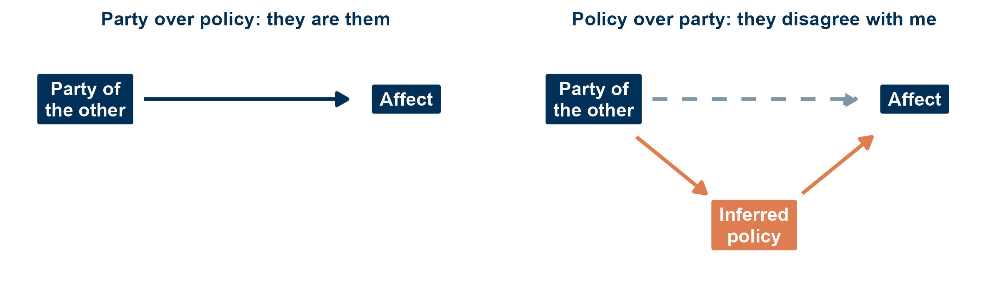
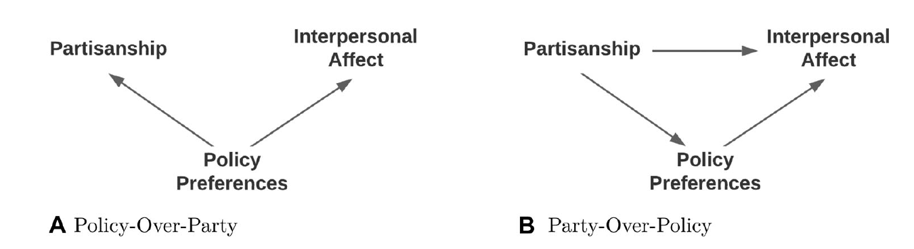
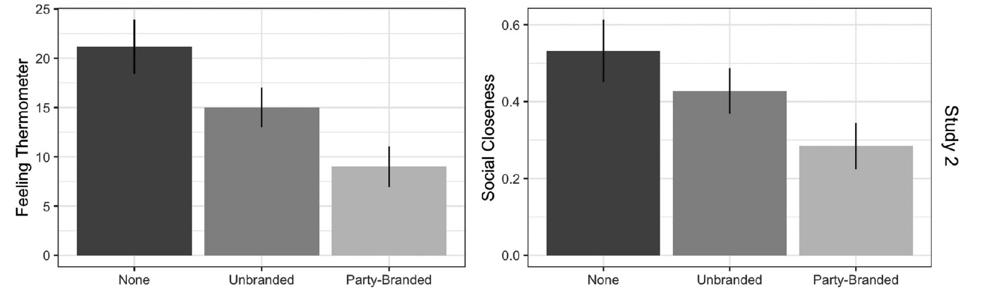
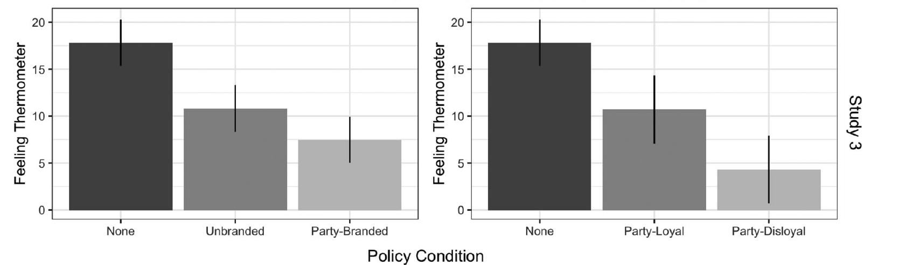
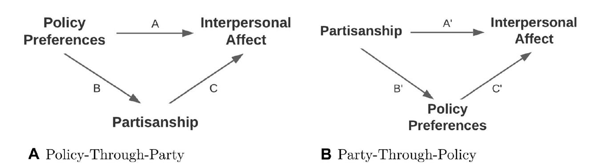
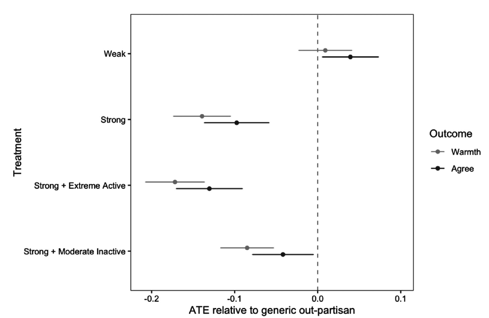

<!--
Session 08, 90 minutes. The 4 November session was cancelled, so this session first closes
session 07 and then turns to its own topic. Time plan, also repeated in the notes of each
section divider:

   0-5   Course evaluation
   5-8   Goals, agenda
         PART 1: FINISHING SESSION 07
   8-15  Four structures (Roccas and Brewer 2002)
  15-18  Why complexity helps
  18-20  From person to society
  20-24  Harteveld (2021) in five lines
         PART 2: PARTY OVER POLICY, OR POLICY OVER PARTY?
  24-27  The puzzle
  27-33  Observational equivalence
  33-37  Pair task (4 min)
  37-40  Exchange
  40-60  Dias and Lelkes (2022), magic five
  60-80  Orr, Fowler and Huber (2023), magic five
  80-84  Discussion: what would settle it?
  84-89  Recap: takeaways and goals
  89-90  Next session

The learning goals are copied from course.yml (weeks, week 8). The deck runs no R, so they
are kept in step by hand, like the title.
The paper crops and the schematic are rendered by scratch/week08-figures.R.
The four structures figure is reused from session 07 (scratch/week07-figures.R).
Figure provenance and rights are listed in images/COPYRIGHTS.md.
-->

## Course evaluation {#sec-evaluation .smaller}

::: notes
- 0 to 5 min, before anything else
- ask kindly, five minutes now, in the session
- the link came by email
- most useful: concrete comments, what to keep and what to change
- thank them, and wait until most are done
:::

Please take **five minutes now** for the course evaluation.

- The link is in your **email**
- Most useful: what should I **keep**, and what should I **change**?

. . .

Thank you!

## Session 08 goals {#sec-week08-goals .smaller}

::: notes
- 5 to 8 min
- first we close session 07, goal 4, which we did not reach
- then the three goals of today
- goal 1 and 3: both papers, goal 2: the problem slide and Orr et al.
:::

First, we close **session 07, goal 4**: social identity complexity.

By the end of today, you will be able to:

1. State the party-over-policy and the policy-over-party positions and the evidence each rests on.
2. Explain why identity and categorisation are hard to separate in survey and experimental designs.
3. Specify what evidence would distinguish the two accounts, and why it is hard to obtain.

## Today {#sec-today .smaller}

::: notes
- part 1 is short, a recap of what was left of session 07
- part 2 is the debate, two papers that answer each other
:::

1. **Part 1: Finishing session 07**
   - Social identity complexity [@roccas2002social]
   - @harteveld2021ticking in five lines
2. **Part 2: Party over policy, or policy over party?**
   - The problem
   - Pair task
   - @dias2022nature
   - @orr2023affective
3. **Wrap-up**

# Part 1: Finishing session 07 {#sec-part1}

::: notes
- 8 to 24 min
- recap only, the full slides are in the session 07 deck
:::

## Four structures {#sec-sic-structures .smaller}

::: notes
- 8 to 15 min
- social identity complexity: how a person sees the overlap among their own in-groups
- subjective: perceived overlap, not objective overlap
- female lawyer, the running example in the paper
- bicultural adaptation, the paper's own illustration
- the arrow is the paper's order (p. 91), after Tetlock's cognitive complexity
- intersection lowest: one small, exclusive in-group
- dominance also low: still a single us-them line
- compartmentalization: differences seen, never reconciled
- merger highest: differences seen and reconciled
- caveat: "degree, not kind", dominance by a large group (women) is more inclusive than by a sect
:::

{#fig-roccas fig-align="center" height="190"}

::: {.xsmall}
| Structure | A woman who is a lawyer | A migrant in a host society |
|---|---|---|
| Intersection | Only women lawyers are "us" | Hyphenated: only my heritage, living here |
| Dominance | Lawyers are "us", woman is a detail | Only the host culture, or only my own |
| Compartmentalization | Lawyer at the office, religion at home | One culture at work, the other at home |
| Merger | All lawyers and all women are "us" | Integrated: both cultures at once |

: The four structures, with the two examples @roccas2002social use themselves. {#tbl-roccas}

Complexity means seeing that one's groups differ **and** reconciling them [@roccas2002social, after Tetlock].
:::

## Why complexity helps {#sec-sic-why .smaller}

::: notes
- 15 to 18 min
- cross-categorization: differences between groups are less exaggerated
- belonging is spread over several groups, so no single one has to carry it
- balance: if a liked in-group member is also in the out-group, disliking the out-group becomes inconsistent
- antecedents: a society with cross-cutting groups, tolerance for ambiguity
- stress and threat push towards simplicity
- evidence: student surveys in the US and Israel, correlations only
:::

- Someone who is "them" on one line is **"us"** on another
- No single group has to carry all of one's belonging
- Disliking a group that contains friends feels **inconsistent**

. . .

- Complexity is lower under **stress** and **threat**, and where groups overlap in society
- First evidence: student surveys in the US and Israel, higher complexity goes with more **tolerance**, correlation only

## From person to society {#sec-sic-society .smaller}

::: notes
- 18 to 20 min
- Roccas and Brewer: a person's mind
- political science: a whole society's structure
- if divides line up in society, people see their groups as one, complexity drops, AP rises
- AP in full: more warmth toward one's own side and more dislike of the other
- the old idea: cross-cutting cleavages keep the peace (Lipset)
- Mason showed it for the US, Harteveld asks whether it travels
:::

1. Divides **line up** in society (social sorting)
2. People see their in-groups as **one** (low complexity)
3. Out-groups look homogeneous and different in every way
4. More **affective polarization**: warmer toward us, colder toward them

. . .

Shown for the US [@mason2016acrosscutting]. Does it travel?

## Harteveld (2021) in five lines {#sec-hv-five .smaller}

::: notes
- 20 to 24 min
- the magic five as the skeleton of the paper, one line each
- details, figures and the method terms are in the session 07 deck
- ask: which part would you attack first? (likely: research design, observational)
:::

The magic five, one line each. Details are in the session 07 slides.

1. **Introduction**: does AP rise where political divides **align** with non-political ones, also outside the US?
2. **Theory**: infusion and complexity, so more social sorting should go with more AP, and the arrow may also run the other way
3. **Research design**: CSES, 119 elections in 40 countries, Cramér's V and fixed effects, plus the Dutch LISS panel with a hybrid model
4. **Results**: within countries, **+0.37 SD** of AP per SD of sorting, nothing between countries, and people who come to fit their party better become more polarized
5. **Conclusion**: AP carries tensions from outside politics, but the evidence is observational and the categories are ascribed

# Part 2: Party over policy, or policy over party? {#sec-part2}

::: notes
- 24 to 84 min
:::

## The puzzle {#sec-puzzle .smaller}

::: notes
- 24 to 27 min
- the fact is not in dispute: partisans like their side and dislike the other
- session 4: Iyengar et al. read this as group identity
- the question today is why
- party over policy: social identity theory, they are them
- policy over party: they want things I oppose
- both labels are Dias and Lelkes' terms
:::

Democrats and Republicans feel warmer toward their **own side** and colder toward **the other**.
The question is why.

. . .

:::: {.columns}

::: {.column width="50%"}
**Party over policy**

- Partisanship is a **social identity**
- I dislike them because they are **them**
- Session 4: social identity theory
:::

::: {.column width="50%"}
**Policy over party**

- Partisanship is a **summary of positions**
- I dislike them because they **disagree** with me
- Session 3: ideological polarization
:::

::::

## Observational equivalence {#sec-equivalence .smaller}

::: notes
- 27 to 33 min
- party tells you about policy: learn someone is a Republican, you guess they oppose abortion
- policy tells you about party: learn someone is pro-life, you guess Republican
- "the issues are in party identification", Fiorina 1981, quoted by Dias and Lelkes
- figure shows: the same data, an out-partisan is rated colder
- left: party itself drives the rating
- right: party only matters because it tells me what they want, the dashed arrow is what we see
- equivalent: both stories predict the same pattern
- ask: what would you need to break the link?
:::

- A **party** label tells you about **policy**: a Republican probably wants abortion restricted
- A **policy** position tells you about **party**: someone pro-life is probably a Republican
- "The issues are in party identification" (Fiorina, quoted in @dias2022nature)

. . .

{#fig-two-stories fig-align="center" height="200"}

::: {.callout-important}
**As long as each signals the other, both accounts predict the same data.**
:::

## Pair task {#sec-pair-task .smaller}

::: notes
- 33 to 37 min
- pairs, four minutes
- warn at 3 min
- a vignette: a short description of a person, respondents rate them
:::

In pairs, four minutes.
You run a vignette experiment: respondents read a short description of a person and rate them.

1. What do you vary at **random**?
2. What do you hold **constant**?
3. Which result would favour **party over policy**, and which **policy over party**?

## Exchange {#sec-exchange .smaller}

::: notes
- 37 to 40 min
- two or three designs on the board
- likely:
  - vary party and policy together, see how much the party effect shrinks (Orr and Huber 2020)
  - use issues without a party line, so policy cannot signal party (Dias and Lelkes)
  - pit agreement against loyalty: a copartisan who agrees but breaks the line (Orr et al.)
  - a group with no policy at all, like a minimal group
- bridge: the first three are the papers of today
:::

:::: {.columns}

::: {.column width="50%"}
**What we vary, what we hold constant**
:::

::: {.column width="50%"}
**Which result favours which account**
:::

::::

# Dias and Lelkes (2022) {#sec-dias}

::: notes
- 40 to 60 min
- the magic five as the reading tool, and the structure of your term paper
:::

## Introduction {#sec-dl-intro .smaller}

::: notes
- RQ: does policy disagreement or partisan identity drive interpersonal animus?
- they react to Orr and Huber (2020): adding a policy position to a vignette cut the party effect by 55 to 62%
- Orr and Huber read that as: animus is mostly about policy
- Dias and Lelkes: those positions were party branded, they also signal identity
- so the old design cannot tell the two apart
:::

- Does **policy disagreement** or **partisan identity** drive interpersonal animus?
- Orr and Huber (2020): adding a policy position to a vignette cuts the party effect by **55 to 62%**
- Their reading: animus is mostly about policy

. . .

- Dias and Lelkes: those positions were **party branded**
- A branded position signals **identity** as well as substance
- So that design cannot tell the two accounts apart

## Theory {#sec-dl-theory .smaller}

::: notes
- figure shows: two causal graphs, arrows are causal effects
- A policy over party: policy causes both party and affect, policy is a confounder
- if so, controlling for policy should make party irrelevant
- B party over policy: party causes policy positions, so policy is a mediator
- controlling for a mediator removes part of party's real effect, overcontrol
- loyalty: a pro-life Democrat is a disloyal Democrat
- social identity research: deviant in-group members are judged harshly, the black sheep effect
- critical test: strip the branding from the policy, see whether it still cuts the party effect
:::

{#fig-dl-dags fig-align="center" height="210"}

- Branded positions may also signal **loyalty**: a pro-life Democrat is a **disloyal** Democrat
- Critical test: does an **unbranded** position cut the party effect as much as a branded one?

## Research design {#sec-dl-design .smaller}

::: notes
- study 1 finds the issues, studies 2 and 3 are the experiments
- branded: people see the parties on opposite sides (guns, DREAMers, same-sex adoption)
- unbranded but as salient: eminent domain, phone carriers selling data, occupational licensing
- study 2 copies Orr and Huber, but adds the branded vs unbranded switch
- outcomes: thermometer, and social closeness (neighbour, child marrying them)
- study 3: same unbranded issues, but the intro says Democrats and Republicans take opposite sides, or only that it was debated
- studies 4 and 5 are robustness checks in the appendix
- all preregistered
:::

::: {.small}
| Study | Sample | What it does |
|---|---|---|
| 1 | 499 US adults, quota sample | Which of 35 issues do people tie to a party? Finds branded and unbranded issues of similar salience |
| 2 | 2,266 MTurk partisans, two waves | Vignettes vary party, whether a position is stated, and whether the issue is branded or unbranded |
| 3 | 1,799 MTurk partisans | Unbranded issues only, randomly **branded** by telling people where the parties stand, and positions loyal or disloyal |

: The three main studies of @dias2022nature. All experiments are preregistered. Studies 4 and 5 are robustness checks. {#tbl-dl-studies}
:::

- Outcomes: feeling thermometer, and social closeness (as a neighbour, marrying one's child)
- The **party effect**: how much warmer a copartisan is rated than an out-partisan

## Results: Study 2 {#sec-dl-results2 .smaller}

::: notes
- figure shows: the party effect, copartisan minus out-partisan, by what else the vignette says
- left: thermometer, right: social closeness
- figure means:
  - no policy: 21 degrees
  - unbranded policy: 15, minus 29%
  - branded policy: 9, minus 57%, about what Orr and Huber found
- every unbranded issue cut less than every branded issue
- gap is large for strong identifiers, not significant for weak ones
- their reading: policy does not confound party, branded positions mediate it
:::

{#fig-dl-study2 fig-align="center" height="230"}

- No policy: **21** degrees warmer toward copartisans
- An unbranded policy cuts this by **29%**, a branded one by **57%**
- The gap is large for **strong** party identifiers, and not significant for weak ones

## Results: Study 3 {#sec-dl-results3 .smaller}

::: notes
- figure shows: the same issues in every bar, only what people were told about the parties differs
- left: branded by the intro or not
- right: the branded positions split into loyal and disloyal
- figure means:
  - branded 58%, unbranded 39%
  - disloyal 76%, loyal 40%
- holding substance constant: only the label differs
- so branding works because it signals identity, in particular disloyalty
:::

{#fig-dl-study3 fig-align="center" height="230"}

- The **same issues** in every condition, only the party label differs
- Branded cuts the party effect by **58%**, unbranded by **39%**
- **Disloyal** positions cut it by **76%**, loyal ones by **40%**

## Conclusion {#sec-dl-conclusion .smaller}

::: notes
- partisan identity is the principal mechanism
- but policy is not nothing: an unbranded position still cuts about a third (29%, 39%)
- figure: their revised model, the two flow through each other
- B: party works largely through branded policy positions
- implication: identity interventions, correcting party stereotypes
- ask: what has to be true about "unbranded" for this test to work?
:::

- **Partisan identity** is the principal mechanism of AP
- Branded positions matter largely because they **signal identity**, above all disloyalty
- Policy still matters on its own: unbranded positions cut about **a third** of the party effect

{#fig-dl-revised fig-align="center" height="150"}

. . .

What has to be true about "unbranded" for this test to work?

# Orr, Fowler and Huber (2023) {#sec-orr}

::: notes
- 60 to 80 min
- a reply: the same data, the opposite reading
- magic five again
:::

## Introduction {#sec-off-intro .smaller}

::: notes
- RQ in the title: identity, loyalty, or substance?
- Orr is the Orr of Orr and Huber (2020), so this answers the critique
- three steps: theory, two new experiments, a direct test
- the provocative claim: Dias and Lelkes found exactly what policy alone predicts
:::

- Is AP driven by **identity**, **loyalty**, or **substance**?
- A reply to @dias2022nature, by the authors of the study they criticised [@orr2020policy]
- The claim: the Dias and Lelkes results are **exactly** what we expect if people care **only** about policy

## Theory: a simple model {#sec-off-model .smaller}

::: notes
- the paper writes it as a regression, here in words
- party effect we measure = caring about party itself + caring about policy times how much party tells you about policy
- the second part is the bias: party is a signal of policy
- stating a policy removes the second part, but only for that policy
- people care about many policies, a vignette states one
- branded issue: party said a lot about it, so stating it removes a lot
- unbranded issue: party said little about it, so stating it removes little
- so branded cuts the party effect more, even if caring about party itself is zero
- this is the bias of the naive estimate, E[beta hat] = beta + gamma times the difference in expected agreement
:::

::: {.callout-note}
**The party effect we measure = caring about party itself + caring about policy × how much party tells you about policy.**
:::

- Stating a policy position removes the second part, but **only for that one issue**
- **Branded** issue: party said a lot about it, so stating it removes a lot
- **Unbranded** issue: party said little about it, so stating it removes little

. . .

So a branded position shrinks the party effect more, **even if caring about party itself is zero**.

## The Elmer Fudd analogy {#sec-off-fudd .smaller}

::: notes
- the paper's own analogy, p. 953
- Elmer likes hunters, and likes people who eat rabbit
- he does not care about hats at all
- a hunting cap signals a hunter
- tell him someone hunts: the cap no longer matters
- tell him someone eats rabbit: the cap still matters, it still signals hunting
- the cap pattern looks like Dias and Lelkes' result, without any caring about caps
- ask: where does the analogy break? (people may care about the cap, the group, after all)
:::

Elmer likes people who **hunt** and people who **eat rabbit**.
He does not care about hats.

::: {.small}
| In the analogy | In the experiment |
|---|---|
| Wearing a hunting cap | Party |
| Hunting | A branded position |
| Eating rabbit | An unbranded position |

: The analogy of @orr2023affective [953]. {#tbl-fudd}
:::

- Learning that someone **hunts** removes the effect of the cap
- Learning that someone **eats rabbit** leaves it, because the cap still signals hunting
- The same pattern as Dias and Lelkes, and Elmer never cared about caps

## Research design {#sec-off-design .smaller}

::: notes
- part 1 is the model of the last two slides
- part 2: can we move perceived identity without moving perceived policy? test it
- strength: weak or strong out-partisan, using the wording of identity scales ("we", "they")
- plus strong and extreme active, strong and moderate inactive
- outcomes: thermometer, and do you think this person agrees with you on policy?
- part 3: reuse Dias and Lelkes' own Study 2 data
- only partisans who disagree with their party on the branded issue shown, 529 cases
- about 30% of partisans disagreed with their party on that issue
:::

::: {.small}
| Part | Data | Question |
|---|---|---|
| 1. A model | None | What does each design predict if people care only about policy? |
| 2. Two experiments | 1,849 partisans, Lucid, 2021 | Does information about identity also move perceived policy, and the reverse? |
| 3. A direct test | Dias and Lelkes' Study 2 data, 529 cases | When agreement and loyalty conflict, which wins? |

: The three parts of @orr2023affective. {#tbl-off-parts}
:::

- Part 3 uses partisans who **disagree** with their own party on the issue in the vignette
- For them, the loyal position and the position they agree with **differ**

## Results: one moves the other {#sec-off-results1 .smaller}

::: notes
- figure shows: effects relative to a generic out-partisan, both outcomes on 0 to 1
- grey warmth, black perceived policy agreement
- figure means:
  - strong out-partisans rated colder, weak no different from generic
  - and perceived agreement drops with it, almost in proportion
  - even strong but moderate and inactive: rated colder, and seen as disagreeing more
- so telling people about identity changes what they think about policy
- second experiment, Figure 2 of the paper: branded positions shift perceived party, other policies, race and religion
- even with the party stated, a position changes perceived party, as Dias and Lelkes thought
:::

:::: {.columns}

::: {.column width="55%"}
{#fig-off-strength height="380"}
:::

::: {.column width="45%"}
- A **strong** out-partisan is rated colder
- And seen as **disagreeing** more, almost in proportion
- Even when described as **moderate** and **inactive**
- Branded positions also shift perceived party, other policies, race and religion
:::

::::

## Agreement against loyalty {#sec-off-results2 .smaller}

::: notes
- the sample: partisans who disagree with their party on the issue shown
- left: copartisans, agreeing but disloyal beats loyal but disagreeing, 73 vs 57
- right: out-partisans, agreeing (and loyal to their party) beats disagreeing but disloyal, 67 vs 52
- all six differences significant, same for strong partisans
- back of the envelope with a second group (those who hold the loyal position): agreement about 30 points, loyalty about 14
- the authors' own words: heroic assumptions, a grain of salt
- so they do find some loyalty, but agreement is about twice as large
:::

::: {.small}
| Evaluating | Agrees with me | Disagrees with me | Difference |
|---|:---:|:---:|:---:|
| A copartisan | 72.7 (disloyal) | 57.1 (loyal) | **15.6** |
| An out-partisan | 66.5 (loyal) | 51.7 (disloyal) | **14.8** |

: Mean feeling thermometer (0 to 100) among partisans who disagree with their own party on the issue shown. Marriage and neighbour items show the same pattern. *Source:* @orr2023affective, Table 1. {#tbl-off-table1}
:::

- When agreement and loyalty **conflict**, agreement wins
- A rough split: agreement about **30** points, loyalty about **14**, "taken with a grain of salt"

## Conclusion {#sec-off-conclusion .smaller}

::: notes
- not "identity does not matter": they find some loyalty
- the claim is about evidence: none of it isolates identity
- perhaps party ID is how ordinary people summarise a bundle of positions
- then separating party and policy may be conceptually meaningless
- advice: check whether an identity treatment also moves perceived policy
- also applies to cue experiments and to vote choice
:::

- Strongly suggestive evidence that people care about **policy agreement**
- Little convincing evidence that they care about identity or loyalty **per se**
- Perhaps party is how people **summarise** a bundle of positions

. . .

- Future designs should check whether an identity treatment also moves **perceived policy**

# Discussion {#sec-discussion}

::: notes
- 80 to 84 min
:::

## What would settle it? {#sec-settle .smaller}

::: notes
- the same finding, two readings
- question 1: unbranded issues may still hint at a side, big or small government
- question 2: wanting loyalty to the line may itself be a policy preference
- question 3: if party is a summary of policy, the question may not be well posed
- link to goal 3: what evidence, and why is it hard to get?
- possible answers: minimal groups, panel data on identity shocks, issues with no ideological content at all
:::

::: {.small}
| | @dias2022nature | @orr2023affective |
|---|---|---|
| Branded positions shrink the party effect more | Because they **signal identity** | Because they say **more about policy** |
| Disloyal positions shrink it most | People punish **disloyalty** | Disloyalty also signals **other positions** |
| Verdict | Identity is the principal mechanism | Policy matters, identity is not shown |

: The same evidence, two readings. {#tbl-two-readings}
:::

- Is an "unbranded" issue ever free of party?
- Is wanting loyalty to the party line itself a **policy** preference?
- If party is a summary of policy, is the question still meaningful?

# Wrap-up {#sec-wrap-up}

::: notes
- 84 to 89 min
:::

## Recap: takeaways {#sec-recap .smaller}

::: notes
- ask for one takeaway before revealing the list
:::

- Complex identities should lower bias, and sorting goes with more AP within countries and persons
- AP is warmth toward one's own side and dislike of the other, but **why**?
- Party and policy **signal each other**, so the two accounts predict the same data
- Dias and Lelkes: branded positions work by signalling **identity**, so identity is the main channel
- Orr et al.: the same result follows from **policy alone**, and agreement beats loyalty when the two conflict

## Recap: learning goals {#sec-recap-goals .smaller}

::: notes
- goal by goal
- ask for each answer before revealing it
:::

::: {.small}
**Session 07, goal 4. Social identity complexity**

- Intersection, dominance, compartmentalization, merger: the more inclusive, the less bias

**Goal 1. The two positions**

- Party over policy: they are them, evidence from branded versus unbranded and from disloyalty
- Policy over party: they disagree with me, evidence from policy information and from agreement against loyalty

**Goal 2. Why identity and policy are hard to separate**

- A party label signals positions, and a position signals party and loyalty, so every treatment moves both

**Goal 3. What would distinguish them**

- A treatment that moves perceived identity but not perceived policy, or the reverse, and both papers show how rarely that holds
:::

## Next session {#sec-next-session}

::: notes
- 1 min
- next week, 18 November
- bridge: today why people dislike each other, next week whether it matters for democracy
:::

- **Session 09: Consequences of affective polarization for democracy**
- Today we asked what AP is about, next we ask what it does
- Which of the alleged harms hold up?
- Core reading: @harteveld2026alleged and @janssen2024breaking

## References {#sec-references .smaller .scrollable}

<!-- .scrollable is allowed here only because this is the reference slide (STYLE.md §5.1). -->

::: {#refs}
:::
