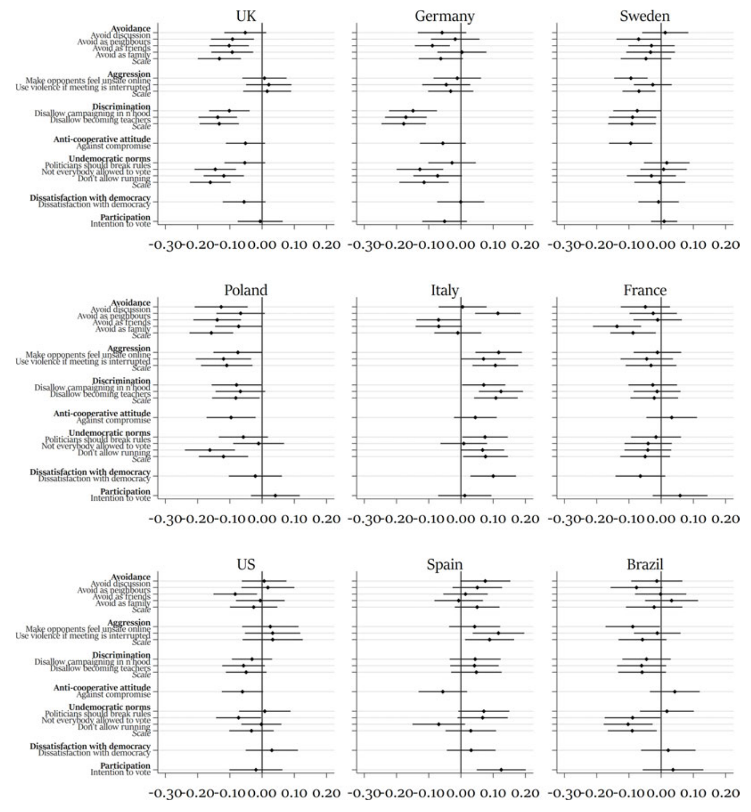
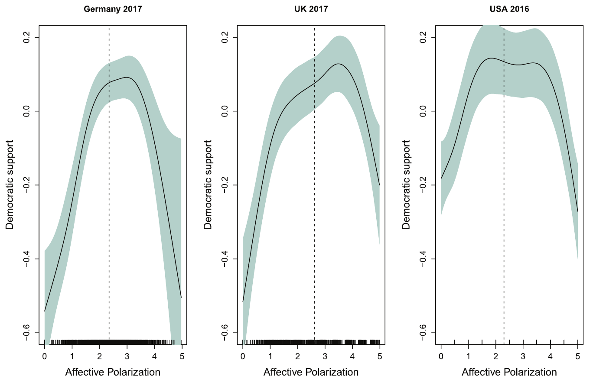

<!--
Session 10, 90 minutes, 25 November. Moved from 18 November for the inaugural lecture,
so the session opens with the two lecture questions from session 09. Time plan, also
repeated in the notes of each section divider:

   0-3   Goals, agenda
   3-12  Back to the lecture
         PART 1: THE ALARM
  12-15  The alarm
  15-18  Mechanisms and doubts
  18-20  Prediction sketch
  20-24  Pair task (4 min)
  24-28  Exchange
         PART 2: TWO READINGS, MAGIC FIVE
  28-53  Harteveld et al. (2026)
  53-56  Discussion: the silver lining
  56-76  Janssen and Turkenburg (2024)
         PART 3: WHAT HOLDS UP?
  76-84  The evidence grid, can both be true?
  84-89  Recap: takeaways and goals
  89-90  Next session

The learning goals are copied from course.yml (weeks, week 10). The deck runs no R, so they
are kept in step by hand, like the title.
The paper crops are rendered by scratch/week10-figures.R.
Figure provenance and rights are listed in images/COPYRIGHTS.md.
-->

## Session 10 goals {#sec-week10-goals .smaller}

::: notes
- 0 to 3 min
- last substantive session, pitches start next week
- goal 1: part 1, goal 2: both papers, goal 3: part 3
:::

By the end of today, you will be able to:

1. Reconstruct the argument for why AP is supposed to harm democracy.
2. Name the consequences that have actually been studied, and the designs used to study them.
3. Distinguish findings that hold up from findings that depend on context or on measurement.

## Today {#sec-today .smaller}

::: notes
- first the lecture, as promised
- then the claim, two papers, and what is left of it
:::

1. **Back to the lecture**
2. **Part 1: The alarm**
   - Why AP should harm democracy
   - How would you test it?
3. **Part 2: Two readings, magic five**
   - @harteveld2026alleged
   - @janssen2024breaking
4. **Part 3: What holds up?**
5. **Wrap-up**

## Back to the lecture {#sec-lecture .smaller}

::: notes
- 3 to 12 min
- the two questions were on the session 09 page
- question a: for, there is a clear us and them, moral language, both sides know who they are
- against: not a party, is it an identity people hold, or a label researchers give?
- question b: education, region, age line up behind it (session 7, social sorting)
- against: in multiparty systems the lines still cross, and the parties are many
- collect for and against on the board, two columns
- bridge: suppose it does produce AP, should we worry?
:::

The lecture ended on the divide between **cosmopolitans** and **communitarians**.

1. Does this divide produce AP, with **warmth** toward one's own side and **dislike** of the other?
2. Is it the **main cleavage**, the one along which party, region, education and religion line up?

::: {.callout-note}
**Session 07: social sorting.**
When divides line up rather than cross, out-groups look different in every way, and AP rises.
:::

. . .

Suppose it does produce AP. **Should we worry?**

# Part 1: The alarm {#sec-part1}

::: notes
- 12 to 28 min
:::

## The alarm {#sec-alarm .smaller}

::: notes
- 12 to 15 min
- both papers open with this claim, quoted almost the same way
- McCoy et al.: polarization as a global crisis of democracy
- Kingzette et al.: AP undermines support for democratic norms, US survey evidence
- Graham and Svolik: voters punish undemocratic candidates only weakly when it costs their side
- ask: what kind of evidence is behind these claims? (mostly correlations, mostly the US)
:::

The claim that motivates the whole literature:

- Polarization as a **global crisis of democracy** [@mccoy2018polarization]
- AP **undermines** support for democratic norms [@kingzette2021affective]
- Citizens become "partisans first and democrats second" [@graham2020democracy, 393]

. . .

::: {.callout-important}
**Most of this evidence is correlational, and most of it comes from the US.**
:::

## Mechanisms and doubts {#sec-mechanisms .smaller}

::: notes
- 15 to 18 min
- both mechanisms from the theory section of Harteveld et al.
- threat: the other side looks dangerous, so I withhold rights, accept fewer losses
- politicization: everyone says yes to democracy in the abstract, fewer when it helps the hated side
- counter: Broockman et al. and Voelkel et al. lowered AP in experiments, avoidance fell, norms did not move
- Broockman's reading: AP shapes judgments that are affect-laden and personal, not judgments about institutions
- this is goal 1
:::

:::: {.columns}

::: {.column width="50%"}
**Why AP should harm democracy**

- **Threat**: the other side looks dangerous, so I deny them rights
- **Politicization of norms**: I endorse democratic rules in the abstract, but not when they help the side I hate
:::

::: {.column width="50%"}
**Why it might not**

- US experiments lowered AP, and **social avoidance** fell [@broockman2023doesaffective; @voelkel2023interventions]
- But support for **democratic norms** did not move
- AP may shape only judgments that are **personal**, not judgments about institutions
:::

::::

## Prediction sketch {#sec-sketch .smaller}

::: notes
- 18 to 20 min
- alone, on paper, two minutes
- no right answer, keep the sketch, we come back to it in the Janssen part
:::

Alone, two minutes, on paper.

- Draw the line from **AP** (x axis, low to high) to **support for democracy** (y axis).
- Keep your sketch. We come back to it.

## Pair task {#sec-pair-task .smaller}

::: notes
- 20 to 24 min
- pairs, four minutes, warn at 3
- session 6: we never see both potential outcomes for one person, random assignment gets the average
- what can go wrong: the treatment does not move AP, it moves something else too, the outcome items are poor
:::

In pairs, four minutes.
You want to know whether AP **causes** weaker support for democratic norms.

1. What do you **randomize**?
2. What do you **measure**, and when?
3. What could go **wrong**?

::: {.callout-note}
**Session 06: potential outcomes.**
We never see one person both polarized and not polarized.
Random assignment still recovers the average effect.
:::

## Exchange {#sec-exchange .smaller}

::: notes
- 24 to 28 min
- two or three designs on the board
- likely:
  - a treatment that lowers or raises AP, then norms items
  - check first that AP actually moved (manipulation check)
  - observational data with controls, then: why is that not enough?
- bridge: the first paper did exactly this, in nine countries
:::

:::: {.columns}

::: {.column width="50%"}
**What we randomize, what we measure**
:::

::: {.column width="50%"}
**What could go wrong**
:::

::::

# Harteveld et al. (2026) {#sec-harteveld}

::: notes
- 28 to 53 min
- the magic five again, as the reading tool and the structure of your term paper
:::

## Introduction {#sec-h-intro .smaller}

::: notes
- RQ: does lowering AP improve social and democratic outcomes?
- the motive: depolarization programmes assume it does
- the gap: correlational evidence, US experiments with null results on norms
- their step: manipulate AP in nine democracies, measure a wide range of outcomes
- N about 18,000, 2,000 per country
:::

- If we **lower** AP, do social relations and democratic attitudes improve?
- Depolarization programmes **assume** so, but the evidence is correlational, or from the US and null on norms

. . .

- A survey experiment in **nine democracies**: Brazil, France, Germany, Italy, Poland, Spain, Sweden, the UK, the US
- About **18,000** respondents, 2,000 per country, fielded in 2022

## Theory: two kinds of harm {#sec-h-theory .smaller}

::: notes
- horizontal: between citizens, vertical: citizen and system
- a continuum, from face to face to abstract
- mechanisms: horizontal through approach and avoidance, vertical through threat and norm politicization
- three scope conditions, why countries may differ:
  - institutions: majoritarian raises the stakes of losing
  - how entrenched AP already is: the US may be locked in
  - a stigmatized radical right out-group: denying it rights may feel democratic
- turnout is the "silver lining": AP might mobilize
- H1 correlation, H2 treatment effect, H3 through citizens rather than elites
:::

::: {.xsmall}
| | Outcome | What it means here |
|---|---|---|
| Horizontal (between citizens) | Avoidance | Keeping social distance from opponents |
| | Aggression | Condoning harassment or violence against them |
| Hybrid | Discrimination | Unequal treatment in routine civic situations |
| Vertical (citizens and the system) | Opposition to compromise | Rejecting cooperation with the least-liked camp |
| | Democratic norms | Rights for all, including disliked opponents |
| | Dissatisfaction with democracy | How democracy works in one's country |
| | Political engagement | Likelihood of voting |

: The seven alleged consequences, from the most interpersonal to the most system-oriented. Adapted from @harteveld2026alleged, Table 1. {#tbl-h-outcomes}
:::

- Effects may differ by **institutions**, by how **entrenched** AP is, and by whether the out-group is a **stigmatized radical right**

## Research design {#sec-h-design .smaller}

::: notes
- three arms, equal probability
- depolarizing: research shows in-party and out-party supporters have quite a lot in common, write down three shared features
- polarizing: very little in common, write down three differences
- control: nothing
- in-group and out-group: the parties whose supporters one likes most and least
- AP = thermometer for most-liked minus least-liked supporters, both components
- session 5: horizontal (supporters) vs vertical (parties), Druckman and Levendusky
- session 7: stressing what groups share is social identity complexity in miniature
:::

Three arms, randomly assigned:

- **Depolarizing**: "Research shows [in-party] and [out-party] supporters actually have quite a lot in common." Write down three shared features.
- **Polarizing**: they have "very little" in common. Write down three differences.
- **Control**: neither

. . .

- AP: thermometer for the most-liked **minus** the least-liked party's **supporters**

::: {.callout-note}
**Session 05: horizontal and vertical AP.**
Here AP is measured toward **citizens**, not parties [@druckman2019we], and keeps both components.
**Session 07:** stressing what the groups share is social identity complexity in miniature.
:::

## Did the manipulation work? {#sec-h-manipulation .smaller}

::: notes
- figure shows: effect of each prompt against control, on the thermometer
- circles: depolarizing, diamonds: polarizing
- pooled: out-group warmth up about 3 points, difference down about 4
- by country: works in UK (about 10), Poland (about 7), Germany, Sweden, Italy (3 to 5), US borderline (p about 0.06)
- France, Spain, Brazil: nothing, Brazil perhaps a ceiling
- polarizing arm failed, even warmed a bit, maybe thinking about the other side humanizes them
- so the main comparison is depolarizing vs control, not the preregistered one
- session 6: a manipulation check, and the deviation is reported openly, appendix K
:::

:::: {.columns}

::: {.column width="55%"}
{#fig-h-manipulation height="415"}
:::

::: {.column width="45%"}
- Depolarizing works in **6 of 9** countries, by 3 to 10 points
- Pooled about 4 points, a third of the gap between weak and strong partisans
- The **polarizing** prompt **failed**, so the comparison becomes depolarizing against control

::: {.callout-note}
**Session 06: check the treatment first.**
No movement in AP, no test of its consequences.
:::
:::

::::

## Results: pooled {#sec-h-results-pooled .smaller}

::: notes
- figure shows: effect of the depolarizing prompt on each outcome, pooled, scaled 0 to 1
- left of zero: less of the bad thing
- H1: every outcome correlates with AP (appendix H)
- H2: avoidance and discrimination down
- norms: two items move, right to run and universal suffrage, rule breaking does not
- compromise: right direction, not significant after Bonferroni
- aggression, dissatisfaction, turnout: nothing
- H3: through feelings about citizens rather than elites
:::

:::: {.columns}

::: {.column width="55%"}
{#fig-h-pooled height="415"}
:::

::: {.column width="45%"}
- In the cross-section, **every** outcome correlates with AP
- In the experiment, **avoidance** and **discrimination** fall
- Support for opponents' right to run and for universal suffrage **rises**

. . .

- **Aggression**, **dissatisfaction** and **turnout** do not move
- Unlike the US studies, a **vertical** outcome moves
:::

::::

## Results: by country {#sec-h-results-country .smaller}

::: notes
- figure shows: the same effects, one panel per country, too dense to read item by item, look at the pattern
- UK, Poland: broad effects, horizontal and vertical
- Germany, Sweden: discrimination yes, norms less (Germany) or not (Sweden, compromise instead)
- reading: radical right out-group, cordon sanitaire, denying rights to it can feel democratic
- session 9 link: the lecture's divide, where the out-group stands outside the consensus
- US: no downstream effects at all, entrenched
- Italy: partly reversed, perhaps fatigue
:::

:::: {.columns}

::: {.column width="55%"}
{#fig-h-country height="440"}
:::

::: {.column width="45%"}
- **UK** and **Poland**: broad effects, horizontal and vertical
- **Germany** and **Sweden**: discrimination moves, norms less so
- **US** and **Italy**: almost nothing, Italy partly reversed

::: {.callout-note}
**Session 09: who is the out-group?**
Where the least-liked camp is a radical right under a cordon sanitaire, denying it rights can feel like the democratic response.
:::
:::

::::

## Conclusion {#sec-h-conclusion .smaller}

::: notes
- not only a social problem, and not a universal threat either
- moderators, their guess: entrenchment (US), party supply and stigma (DE, SE)
- limits in their words: breadth over depth, items did not always perform
- reliability: avoidance 0.53, norms 0.35, low
- one short stimulus, no durability
- policy: a cheap prompt does something
- term paper: preregistered, deviations reported, replication code on OSF
:::

- Depolarizing improves **interpersonal** outcomes, and in several countries **democratic norms**
- The consequences of AP are **contingent**, not universal

. . .

- Limits: one short prompt, effects measured right away
- Item scales are weak: reliability (Cronbach's α) is 0.53 for avoidance and 0.35 for norms

::: {.callout-tip}
**For your term paper.**
A pre-registration, deviations reported openly, and replication code on OSF.
:::

## Discussion: the silver lining {#sec-silver-lining .smaller}

::: notes
- 53 to 56 min
- silver lining: Harteveld and Wagner 2023, AP raises turnout
- turnout correlates with AP in their data, but does not move in the experiment
- possible readings: confounding, e.g. interest drives both, or the effect is too small to see, or stable intentions
- goals 2 and 3
:::

Turnout **correlates** with AP, but does **not move** when AP is lowered.

- What does that do to the claim that AP **mobilizes** voters?
- What else could produce the correlation?

# Janssen and Turkenburg (2024) {#sec-janssen}

::: notes
- 56 to 76 min
- a research note, short, theory lives in the introduction
- that is a format you can use for a term paper
:::

## Introduction {#sec-j-intro .smaller}

::: notes
- RQ: why are the findings on AP and democratic support mixed?
- their answer: everyone assumed a straight line
- a research note: no separate theory section
:::

- Some studies find AP **erodes** democratic support, others find **nothing**
- Their answer: everyone assumed a **straight line**

. . .

- The relation may be **curvilinear**: an inverted U
- A **research note**: short, the theory sits inside the introduction

## Theory: a sweet spot? {#sec-j-theory .smaller}

::: notes
- low end: no party attachment, nothing at stake, why care about democracy?
- party ID makes people feel represented, Dassonneville and Hooghe on alienation
- session 8: they cite Dias and Lelkes and Orr et al. for party identification
- high end: the opponent becomes an enemy, Graham and Svolik
- built on Torcal and Magalhães (2022), the same shape for perceived ideological polarization
:::

:::: {.columns}

::: {.column width="50%"}
**Too little AP**

- No party one feels **attached** to
- Nothing at stake, so why care about democracy?
- Party identity makes people feel **represented**
:::

::: {.column width="50%"}
**Too much AP**

- The opponent becomes an **enemy**
- Losing becomes unacceptable
- "Partisans first and democrats second"
:::

::::

. . .

- Hypothesis: support for democracy is **highest** at moderate AP
- The same shape was found for perceived **ideological** polarization [@torcal2022ideological]

::: {.callout-note}
**Session 08: party identity.**
The low end rests on partisanship as an attachment, citing @dias2022nature and @orr2023affective.
:::

## Research design {#sec-j-design .smaller}

::: notes
- CNEP: Comparative National Election Project, post-election surveys
- only three countries had both the democracy items and party like/dislike
- DV: representative democracy good, plus three autocratic alternatives reversed, one factor
- IV: Wagner's spread, the measure from session 5
- vertical: parties, not supporters, unlike Harteveld
- GAM: a flexible curve, the data choose the shape, no straight line imposed
- then quadratic OLS as a check
- controls: extremism, left-right, economy, interest, education, gender, age
:::

- Survey data: **Germany** 2017, **UK** 2017, **US** 2016 (Comparative National Election Project)
- Democratic support: representative democracy, against army rule, one party, a strong leader
- AP: Wagner's **spread** over party like/dislike ratings

. . .

- **Generalized additive models**: the data choose the shape of the curve
- Then a regression with a squared term as a check

::: {.callout-note}
**Session 05: the spread measure.**
@wagner2021affective, rated toward **parties** (vertical), whereas Harteveld et al. rate **supporters**.
:::

## Results: an inverted U {#sec-j-results .smaller}

::: notes
- figure shows: estimated democratic support across AP, shaded band 95% interval, dashed line the country mean
- Germany: peak around 2.5 to 3 (paper says about 2.5)
- UK: peak about 4
- US: flat top between 1.5 and 3.5
- in all three, the mean is at or below the peak
- back to the sketches: who drew a curve? who drew a falling line?
:::

{#fig-j-gam fig-align="center" height="260"}

- An **inverted U** in all three countries, flatter at the top in the US
- The average citizen sits **at or before** the peak, not past it

. . .

**Your sketch:** who drew a curve?

## If you fit a line {#sec-j-linear .smaller}

::: notes
- linear model: US nothing, Germany and UK a small positive slope (0.087, 0.075)
- so a straight line would say AP is harmless or even good
- squared term improves the fit in all three
- robustness: control for perceived ideological polarization, drop zeros, mean distance measure, efficacy
- reanalysis of Voelkel et al.'s US experiment data, a thermometer toward supporters: same curve
:::

- A **linear** model finds nothing in the US, and a **positive** slope in Germany and the UK
- The squared term fits better in all three

. . .

- Robust to other AP measures, to more controls, and to dropping zero scores
- The same curve in the US experiment data of @voelkel2023interventions

::: {.callout-important}
**A null in a linear model is not evidence of no relationship.**
Check the shape before you fit a line.
:::

## The left end {#sec-j-left-end .smaller}

::: notes
- who has AP zero? someone who rates every party the same
- footnote 6: mostly people who rate all parties 0
- that is disillusionment, not calm, no in-party at all
- they drop them as a robustness check, the curve stays
- but the point stands: low AP is a mix of the content and the disaffected
- session 5: the measure decides who counts as polarized
- session 4: both components, someone with no in-group liking has no AP even if they hate everyone
:::

Who scores **zero** on AP?

. . .

- Someone who rates **every** party the same
- Often: someone who rates every party **zero**
- That is **disillusionment**, not calm

::: {.callout-important}
**Session 05: the measure decides what "low AP" means.**
With both components, someone who dislikes every party has no in-group warmth, and so no AP.
The authors drop these respondents as a check, and the curve survives.
:::

## Conclusion {#sec-j-conclusion .smaller}

::: notes
- a sweet spot: enough AP to care, not so much that democracy becomes an obstacle
- worry about the extremes, not the average
- method: test for non-linearity, GAMs or squared terms
- limits: cross-sectional, three countries
- session 6: reverse causality, people who care little for democracy may stop telling parties apart
:::

- A **sweet spot**: enough AP to care, not so much that the other side becomes an enemy
- Worry about the **extremes**, not the average

. . .

- Limits: three countries, one point in time
- Cross-sectional, so the arrow may run **the other way**

::: {.callout-note}
**Session 06: no random assignment, no causal claim.**
Weak democratic support may come first and flatten party ratings.
:::

# Part 3: What holds up? {#sec-part3}

::: notes
- 76 to 84 min
:::

## The evidence grid {#sec-grid .smaller}

::: notes
- 76 to 81 min
- ask first, row by row, then reveal
- goal 3: correlations everywhere, effects only in some places
:::

For each outcome: does it **correlate** with AP, and does it **move** when AP is lowered?

. . .

::: {.small}
| Outcome | Correlates with AP | Moves when AP is lowered | Verdict |
|---|:---:|:---:|---|
| Avoidance, discrimination | yes | yes | Holds up best |
| Democratic norms | yes | partly | Depends on the country |
| Aggression | yes | no | Rare, close to the floor |
| Dissatisfaction, turnout | yes | no | Correlation only |
| Democratic support overall | inverted U | not tested | Depends on the shape |

: What holds up, combining @harteveld2026alleged (rows 1 to 4) and @janssen2024breaking (row 5). {#tbl-grid}
:::

## Can both be true? {#sec-both-true .smaller}

::: notes
- 81 to 84 min
- two ways a claim can fail with the correlations in place: causation, shape
- can both be true? plausibly, if the experiment lowers AP from levels at or past the peak
- careful: that is our inference across two measures (supporters vs parties), not a finding of either paper
- both: resist alarmism and complacency, almost in the same words
- term paper: three habits to take along
:::

Two ways a widely shared claim fails, even when the correlations are real:

- **Causation**: lowering AP changes some outcomes, not all [@harteveld2026alleged]
- **Shape**: more AP is not always worse [@janssen2024breaking]

. . .

- Both papers: resist both **alarmism** and **complacency**

::: {.callout-tip}
**For your term paper.**
Ask whether your correlation is a cause, check the shape before fitting a line, and share your code.
:::

# Wrap-up {#sec-wrap-up}

::: notes
- 84 to 89 min
:::

## Recap: takeaways {#sec-recap .smaller}

::: notes
- ask for one takeaway before revealing the list
:::

- The alarm rests on **threat** and **politicized norms**, and mostly on correlations
- Lowering AP reduces **avoidance** and **discrimination**, and in some countries strengthens **norms**
- Effects depend on **context**: little in the US, less where the out-group is stigmatized
- The relation with democratic support looks like an **inverted U**, not a line
- What "low AP" means depends on the **measure**

## Recap: learning goals {#sec-recap-goals .smaller}

::: notes
- goal by goal
- ask for each answer before revealing it
:::

::: {.small}
**Goal 1. Why AP should harm democracy**

- Threat makes people deny rights to the other side, and hostility makes them apply democratic norms only when it suits their side

**Goal 2. Consequences studied, and how**

- Horizontal: avoidance, discrimination, aggression. Vertical: compromise, norms, satisfaction, turnout, democratic support
- A depolarizing survey experiment in nine countries, and survey data with flexible curves in three

**Goal 3. What holds up**

- Avoidance and discrimination hold up, norms depend on the country, turnout and satisfaction are correlation only
- The direction of the relation depends on where people sit on the curve and on how AP is measured
:::

## Next session {#sec-next-session .smaller}

::: notes
- 1 min
- 2 December, pitches I
- those originally scheduled for 25 November present
- check the schedule on the website
- the magic five as the pitch skeleton, the same tool we used on every paper
:::

- **Session 11: Term paper pitches I**, 2 December
- If you were scheduled for 25 November, you present **next week**
- A research question, why it matters, a design, and your data
- Ideally, your pitch follows the **magic five**:
  1. **Introduction**: your research question, and why it matters
  2. **Theory**: your argument, and what you expect
  3. **Research design**: how you will answer the question
  4. **Results**: what form your results will take
  5. **Conclusion**: what can and cannot be learned from it, and its limits

## References {#sec-references .smaller .scrollable}

<!-- .scrollable is allowed here only because this is the reference slide (STYLE.md §5.1). -->

::: {#refs}
:::
